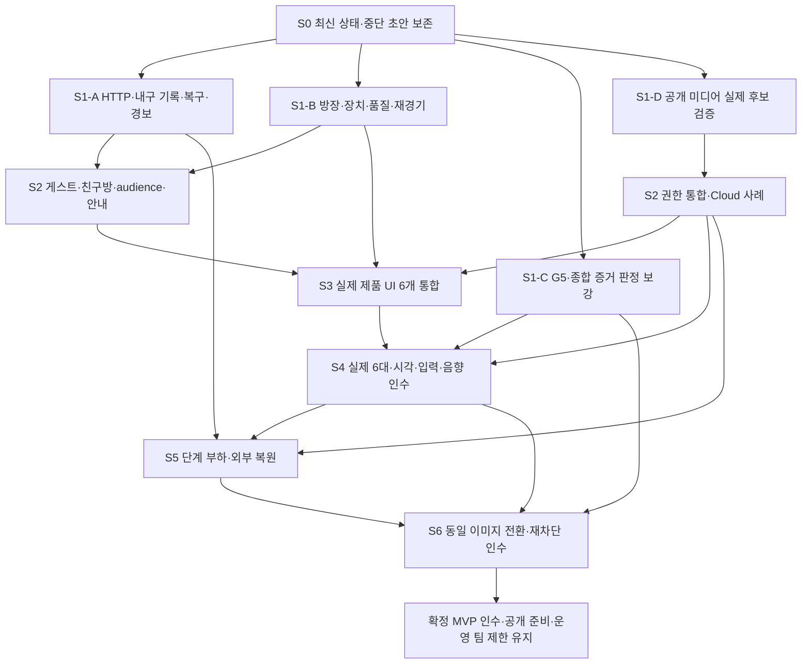

# 까꿍 MVP 완성 실행계획

작성일: 2026-09-13

갱신 기준: 2026-09-13 19:07 KST, 원격 develop/운영 `1cb41f05b966740ad88dcc0d3b21c4540ecb9713`

상태: 재검토 후 사용자 요청으로 구현 재개. 완료 실적·미커밋 초안·추가 결함·잔여 인수를 구분해 S0–S6 순서로 진행한다. [최신 검토](mvp-plan-review-2026-09-13.md), [중단·재개 기록](mvp-resume-2026-09-13.md), [구현 기록](mvp-implementation-progress.md)을 함께 읽는다. 재개 요청에 따라 Jira·브랜치·검증·커밋·푸시·MR·병합·배포를 작업별로 확인한다.

## 1. 이번 작업의 목표와 확정 범위

**팀원 전용 접속 제한을 유지한 상태에서 게임·렌더링·운영·공개 준비를 모두 완성한다. 마지막에는 검증된 공개 대상 설정만 전환하면 일반 이용자가 플레이할 수 있어야 한다.**

사용자의 이번 결정은 다음 두 가지다.

- 도망자 아이템은 이번 MVP 구현·필수 시험 범위에서 제외한다.
- 현재 도메인의 GitLab 프로젝트 팀원 접속 제한을 유지한다. 실제 일반 공개 전환은 이번 완료 범위에서 제외한다.

[최신 기획서](spec/current.md)의 Q01은 이번 MVP에 한해 제외 결정으로 좁혀 해석한다. 영구 폐기 결정은 아니다. MP-06·EQ-06·EQ-07·EQ-08·EQ-09·EQ-12의 기존 추적 번호를 삭제하거나 완료로 바꾸지 않는다. G3-C 및 G5의 아이템 전용 행동도 성공으로 계산하지 않는다. 결정 이력·상태 표기·판정기 갱신은 W00/W20에서 함께 처리한다.

술래 감지기·덫, 구속·자연 만료·재구속 면역, 포획, 개인 출구·포즈 탈출, 지도 교환, 실제 얼굴·음성, 재경기는 유지한다.

이번 계획의 W00–W20 및 V0–V5는 계획 관리 번호다. 기존 122개 ID나 실제 Jira 키를 대체하지 않는다. 이 계획을 작성했다는 이유만으로 Jira 생성·제품 구현·커밋·배포를 완료했다고 계산하지 않는다.

## 2. MVP 완료의 정의

다음 조건을 모두 충족한 상태를 목표로 한다.

1. 처음 접속한 사람이 설명을 듣지 않고 환경 점검·연습·친구 초대·경기·결과·재경기를 진행한다.
2. 이동·회전·지도·술래 장비·포획·탈출이 일관되게 동작하며 실패 이유와 복구 방법을 화면에서 알 수 있다.
3. 맵·캐릭터·얼굴·장비·출구·HUD가 같은 미술 기준으로 완성되고, 실제 플레이에서 긴장감과 가독성 및 성능을 함께 통과한다.
4. 공개 환경을 전제로 미디어 권한·악용 방어·방/좌석/자원 회수·개인정보 안내·자산 권리를 정리한다.
5. 실제 Cloud, 실제 6대 5판, 10방 부하, 장애·복원 관문을 통과한다. 자동 시험 개수로 대체하지 않는다.
6. 동일한 제품 빌드로 격리 환경에서 팀 제한→일반 이용→팀 제한 복귀를 검증한다. 운영 도메인은 팀 제한 상태를 유지한다.
7. 마지막에 남는 것은 실제 공개 시점과 공개 대상 설정 전환뿐이다. 미디어 방식·입장 구현·라이선스·핵심 제품 정책이 미결정으로 남아 있으면 완료가 아니다.

완료 결과는 `MVP_ACCEPTED`, `PUBLIC_READY`, `ACCESS_TEAM_ONLY` 세 상태로 구분해 보고하도록 제안한다. 이 이름들은 새 판정 상태의 제안이며 현재 구현된 필드 이름은 아니다.

## 3. 현재 구현과 남은 공백

현재 develop과 운영 #109는 `1cb41f05`로 일치한다. 실제 Cloud DP-06 PASS,
READY/OPEN·미해결0·last-good·팀 SSO를 확인했다. 아래 W 표는 재개 후 상태이며,
오전 K01–K11 재검토와 과거 실패/중단 이력은 [재검토](mvp-plan-review-2026-09-13.md)에 보존한다.

196·198–209로 방장 잠금/강퇴, 장치/품질/명단/결과, 준비 정체, HTTP/감사 상한,
내구 기록 축약/복구, 경보/TTL 정합과 증거 판정 보강을 병합·배포했다.
192 실제 Cloud 진단에서는 수신 방 격리 전달 후보를 검증했고 정상 publisher의
목록 변조 우회를 재현했다. 211 MC-PUBLIC-02에서도 얼굴 유지·음성 차단·동일 목적지 재허용을
실제 Cloud로 검증했다. [증거와 용량 한계](split-media-proof.md)를 따르며 공개 제품 권한은 아직 미완료다.
210 친구 초대는 전체 검사·MR !135·배포 #106·Jira 완료를 확인했다.
211은 MR !136·배포 #107·Jira 완료를 확인했다. 212 게스트 입장/서버 audience·홈과
213 운영 파일 검사 지연 뒤의 재검증 복구는 통합2,576개·21 E2E 및 정확한 소스 CI를
통과해 MR !137·배포 #108을 완료했다. 이전 재경기 간헐 실패의 최초 원인은 미확정이다.
214의 실제 얼굴·자세·손 추적 모델 근거와 제품 고지는 MR !138·배포 #109·Jira 완료를 확인했다.
손동작 분류 구성과 SDK 번들 고지는 계속 pending이다. 215는 분리 grant·웹 연결/게시/바인딩을
구현하고 실제 제품 어댑터의 Cloud 시험을 연결하는 중이며 서버 세대/회수/사용량 통합은 남는다.

실제 인수 증거 수집, 공개 권한/단일 audience 통합, 장치/렌더/부하/외부 복원과
문의/자산 권리가 남는다. 이미 완료한 구현을 재구현하거나 자동 검사 수를 MVP 인수로
계산하지 않는다. 소스·CI·MR·Jira·배포별 실제 결과는 [구현 기록](mvp-implementation-progress.md)을 따른다.

## 4. 착수 전에 고정할 정책

아래 권고는 계획을 실행 가능하게 만드는 기본안이다. 2026-09-13 사용자가 계획에 따른 구현을 승인했다. 실제로 채택한 정책은 [결정 정정표](spec/decisions.md)에 기록한다. 비용 한도·경보 수신자처럼 아직 제공되지 않은 값과 실제 Cloud 지원 여부는 임의 확정하지 않는다.

| 항목                    | 권고 기본안                                                                                                                         | 결정 결과가 필요한 작업 |
| ----------------------- | ----------------------------------------------------------------------------------------------------------------------------------- | ----------------------- |
| 일반 이용자와 모임 방식 | 서버 발급 게스트 세션 + 친구 초대방. 현재 운영 접속에는 팀원 SSO 유지                                                               | W07·W13                 |
| 최초 장치 조건          | PC 브라우저·카메라 필수, 마이크 선택 유지. 실제 통과한 OS/브라우저/장치 목록 명시                                                   | W08·W10·W18             |
| 게임 소켓 상실          | 첫 MVP는 현행 경기 무효 정책을 명확히 안내하고 같은 방 재모집/재경기를 완성하는 안 권고. 인증 재접속을 선택하면 별도 복구 작업 추가 | W03·W12·W18             |
| 방 체류                 | 시작점 제안: 무활동 로비 10분, 준비 정체 5분, 결과/중단 5분. 종료 60초 전 안내. heartbeat만으로 연장하지 않음                       | W03                     |
| 방장 제어               | 친구방 초대 재발급/회수, 입장 잠금, 로비 강퇴. 경기 중 강퇴를 허용하면 중단·결과·재입장 정책도 함께 정의                            | W07·W13                 |
| 수신 제어               | 자기 마이크, 사용자 음량, 상대별 수신 음소거, 퇴장, 문의 경로. 서버의 금지 수신을 사용자 설정으로 다시 열 수 없게 함                | W11·W13                 |
| 공포·미술 방향          | 좁은 실내 시설 1종을 먼저 완성. 재질·국소 조명·멀리 보이지 않는 공간·사람 얼굴·공간음으로 긴장감 형성                               | V0–V5                   |
| 품질 목표               | 현행 중간 평균 45fps·저사양 30fps를 유지. 오입력·보정·첫 경기·공포/불편 기준은 첫 표본 후 고정                                      | W10·W18·V5              |
| 용량·비용·운영          | 기존 10방 목표 유지, 검증된 용량만 허용. 유료 전환 한도·경보 수신자·지원 시간·복원 목표를 정함                                      | W14·W19                 |
| 공개 미디어             | W01의 실제 SDK/Cloud 검증 결과로 확정. 정상 송신 앱 협조만으로 공개 인수하지 않음                                                   | W02·W06·W19             |

위 체류 시간은 D-2026-09-13-01에 따라 첫 구현 정책으로 채택했다. 208/#103에서 실제 운영 로비600000ms를 확인했고 안내/만료/회수 회귀를 통과했다. 전체 방의 활동과 개인 AFK를 구분하며, 한 명의 비활동 때문에 다른 참가자의 정상 경기를 임의로 종료하지 않는다. 로비의 입장/예약은 무활동 시간을 갱신하지만, 장치 준비·결과·중단은 단계 진입부터 기한을 계산한다.

자동 매칭·봇·랭킹·영구 전적·모바일 지원·추가 맵 테마는 현재 부족분을 해결하는 선행 작업으로 넣지 않는다. 별도 확장 결정을 내리면 이 계획과 분리해 산정한다.

## 5. 최신 작업 상태와 의존성

아래 상태는 코드·병합·실제 인수를 나눈다. “부분”은 이미 병합한 범위를 다시 구현하라는
뜻이 아니다. 담당은 기존 A–F 소유권이며 공통 계약과 실제 생산자/소비자를 함께 검증한다.

| 번호 | 최신 상태·잔여 산출물                                                                     | 선행·착수 구간                   | 주관/협업   |
| ---- | ----------------------------------------------------------------------------------------- | -------------------------------- | ----------- |
| W00  | 아이템 MVP 제외·팀 제한·기본 정책 결정 반영. 지원 장치·비용·경보 수신자 등 실제 값 미확정 | S0, 다른 구현과 병행             | 제품·B/F    |
| W01  | 192 실제 Cloud 후보 진단 통과: 수신 방 격리 전달 검증, publisher 변조 우회 재현           | S1-D 완료, W02 제품 설계로 연결  | E·D·F       |
| W02  | 211 실제 분리·재허용 통과.215 웹 연결/게시/바인딩 진행, 공개 서버 발급/회수·사용량 미완료 | S2 진행, 현 팀 모드 유지         | E·B·D·F     |
| W03  | 186/198/208 만료·경고·MAP_FINALIZING 기한과 실제 로비10분 배포 완료                       | 실제6대/장기 인수 S4/S5          | B·E·F       |
| W04  | 204/206 HTTP/IP/인증·대기/감사 표본 상한 배포 완료. 명령 requestId 장기 인덱스 별도       | S1-A 구현 완료, 실제 부하 S5     | B·E·F       |
| W05  | 209 호환 reader→자동 축약→검증된 과거 방 조회를 #103–105 배포, 실제 축약 확인             | 실제 장기/최대 부하·외부 복원 S5 | E·B·F       |
| W06  | 191/201 판정기 보강 병합. 실제 G1/성능/제품흐름/단계 부하 관측 생산자 미완료              | W02 통합→S3 도구→S4/S5 실측      | F·E·D·B     |
| W07  | 196/210/212 게스트·서버 audience/홈 배포 완료. ingress/릴리스·격리 전환 남음              | S2, W02/W04 통합                 | B·F·C       |
| W08  | 193 개인 체험·199 장치 경계 배포. 실제 초보/카메라·모션 인수 남음                         | S4                               | C·D         |
| W09  | 187/196/202 행동 조건·명단 순서·역할별 연습 안내 배포                                     | 제품6화면 S3·초보 인수 S4        | C·B·D       |
| W10  | 188 One Euro·표본 수명 병합. 실제 중립/의도 지연 튜닝 남음                                | S4, 관측 도구는 S3               | D·C         |
| W11  | 194/199 음향 제어·마이크 분리·품질 복원 배포. 실제 원격 얼굴/음향 인수 남음               | S4, 최종 W02                     | D·C         |
| W12  | 196/198/202 명단/개인+팀 결과/맵 준비 정체 안내 배포                                      | 제품6화면 S3·재경기 실장치 S4    | C·B         |
| W13  | 수신/방장/초대·214 비전 근거/고지 배포. 분류·SDK 번들 권리와 처리/보관/문의 남음          | S2, W07/W11                      | C·B·D·E     |
| W14  | 195/200/203–209/213 복구·배포 안정화 완료. 외부 경보 전달·백업/복원·자원/권리 남음        | 외부 확인 S2–S5                  | F·E·D       |
| W15  | 기존 규칙·맵 결정적 회귀 존재. 실제 초보·역할 교환 밸런스 미인수                          | 회귀 S3, 체감 S4                 | A·B·C       |
| W16  | 189 V0–V4 구현·V5 도구 병합, 최종 장면/성능/체감 미인수                                   | S3 통합→S4                       | C·A·D·F     |
| W17  | 부분 E2E 존재. 실제 제품0.2 UI6개 전체 흐름 미완료                                        | S1-B/S2 계약 안정화→S3           | F·C·B·D     |
| W18  | 실제 6대5판·신규 그룹 인수 미실행                                                         | K03·G1/G4·S3 선행→S4             | 전원·F 집계 |
| W19  | 실제 단계 부하·10방900초·외부 호스트 복원 미실행                                          | W02/W03–06/W14, 예산/장비→S5     | F·B·E·A     |
| W20  | 201 실제 증거 검사·모드 분리 병합. 최종 동일 이미지 격리 전환 인수 미실행                 | W02/W07과 실제 모든 관문→S6      | F·B·E·C     |

### 재개 시작점과 실행 구간

S0/S1의 안정화·증거 판정 수정,210 친구 초대 배포와211 실제 분리 전달 진단을 진행했다.
213 운영 설정 검사 지연 복구·최초 잠금 진단과212 게스트 입장의 최종 통합을 완료했고,
S2의 W02 공개 권한 제품 통합과 W07 ingress/릴리스 audience 준비로 이어간다.
아래 S0/S1 설명과 그림은 전체 의존성을 보존하며 완료 코드를 다시 만드는 요청이 아니다.

S1은 네 갈래다. **운영 안정화, 196/FE 안정화, 증거 판정 보강, 공개 미디어 구조 검증**을
파일 소유권에 맞게 병행한다. 자세한 시작 파일·회귀·각 묶음의 끝은
[재검토 문서 5절](mvp-plan-review-2026-09-13.md#5-다음-실행의-구간과-종료-기준)을 따른다.

W07의 비활성 코드 구현은 W01과 병행할 수 있지만 공개 준비 완료 판정은 W02의 실제
권한 검증을 기다린다. 운영/권리 W14도 마지막 장식 작업으로 미루지 않는다.

## 6. 서버·미디어 작업의 구체 완료 조건

아래는 유지할 최종 기준이다. W03–05의 기존 병합 부분은 5절 상태를 따르며 새로 확인된 운영/미디어 HTTP 경계·내구 기록·조회 복구(K01/K02/K10)를 포함한다. 완료된 캐시·Room 기능을 다시 미구현으로 집계하지 않는다. 연습60초·로딩30초 기한은 유지하며 MAP_FINALIZING 회수 미확인 대기(K11)는 별도로 기한/오류 안내를 연결한다.

### W01–W02: 공개 권한

- 기존 MC-01과 합성 얼굴/음성 표식을 재사용해 정상 송신/변조 송신 × 정상 수신/변조 수신 조합을 비교한다.
- API 성공과 실제 수신 성공을 구분한다. 허용 대조는 받아야 하고 금지 대상은 SFU 경로에서 차단되어야 한다.
- 늦은 allow 뒤 deny, 개인 종료와 권한 응답의 역전, 옛/갱신/미입장 토큰, 새 SID·같은 SID 소스 교체, 순간 재연결·전체 세대 교체를 시험한다.
- 허용 목록 응용만으로 해결했다고 단정하지 않는다. 공식 SDK의 송신자 허용 목록과 서버 UpdateSubscriptions는 별도 API이므로 실제 조합으로 검증한다.
- 회수 실패·응답 불명 시 좌석/예산/다음 세대를 성급하게 해제하지 않는다. 정상 상대 5명의 세대는 유지한다.
- 기술 검증을 1–2인일로 제한하고, 해결하지 못하면 실패 원인과 대안의 게임 규칙·비용·운영 영향을 제시해 구조를 결정한다.

G1은 정의된 미디어 경로의 수신 권한 검증이다. 변조 송신자가 내보낸 픽셀이 반드시 가공 얼굴임을 서버가 증명하거나, 상대 단말의 녹화를 막는다는 보장은 아니다. 이 신뢰 경계는 W13의 안내와 일치시킨다.

### W03–W05: 장시간 켜두어도 버티는 서버

- 연결된 AFK 로비, 장치 준비 정체, RESULT/ABORTED 체류를 각각 실제 Room 종료·세션 무효화·미디어 회수·좌석 반환까지 연결한다.
- ACTIVE 경기의 기존 결과/무효 정책과 개인 종료자 처리를 유지한다. 만료와 재경기·신규 입장이 동시에 일어나도 한 번만 정리한다.
- malformed 메시지와 상태 조회에도 공통 요청/바이트 한도가 적용된다. 연결 수·IP/세션 키·응답량을 제한해 거절 응답 자체가 부하를 키우지 않게 한다.
- 정상 6인 입력과 제한 초과 트래픽을 동시에 넣어 정상 명령·Tick·미디어가 유지되는지 확인한다.
- limiter는 키 TTL·최대 키 수·키당 저장 상한을 가진다. 거절한 요청을 무제한 배열에 쌓지 않는다.
- 완료 scope·만료 초대·오래된 요청의 정리 시점을 정의한다. 진행 중 요청, 회수 미확인 세대, 중복 요청 거절에 필요한 기록은 유계 보존한다.
- 10,000회 반복 요청 및 반복 방 생성/종료에서 컬렉션 상한과 메모리 추세를 확인한다. 단일 작은 단위시험만으로 장기 메모리 안정성을 선언하지 않는다.

### W06: 실제 시험 도구 연결

아래는 현재 BLOCKED 구현이 남아 있는 주요 파일이다.

| 사례                                                          | 실제 연결할 행동                                                        |
| ------------------------------------------------------------- | ----------------------------------------------------------------------- |
| [G1-A](../tests/cloud/g1-a.cloud.test.ts)                     | 지연된 허용/차단 경쟁과 불허 수신자의 직접 구독                         |
| [G1-D](../tests/cloud/g1-d.cloud.test.ts)                     | 종료·회수 경쟁과 옛 토큰 재접속                                         |
| [G1-B](../tests/cloud/g1-b.cloud.test.ts)                     | 격리 서버 강제 종료·같은 저널로 재시작·기존 토큰 회수                   |
| [G1-C](../tests/cloud/g1-c.cloud.test.ts)                     | 새 SID/같은 SID 교체·일부 참가자 재연결                                 |
| [성능](../tests/cloud/performance.cloud.test.ts)              | 대표 실제 GPU의 3모델·R3F·160×160 얼굴 업로드·원격 얼굴 5트랙 동시 성능 |
| [제품 흐름](../tests/cloud/mvp-flow.cloud.test.ts)            | 초대→준비→연습→경기→결과→재경기 보조 trace                              |
| [단계 부하](../tests/cloud/staged-load.cloud.test.ts)         | 1·3·5방 실제 게임/관리 API/미디어 동시 계측                             |
| [10방 통합](../tests/cloud/ten-room-integrated.cloud.test.ts) | 60세션·정상/전환 구간·정리 판정                                         |

[MC-01](../server/test/media/capability.cloud.test.ts), [DP-06](../tests/cloud/deployment-smoke.cloud.test.ts), 기존 ProbeHarness/DeploymentBrowserPool, [G4 metadata](../tests/cloud/g4-metadata.cloud.test.ts)를 재사용한다. Cloud 예산 사전검사·표식 관측·실패 시 정리·비밀값 제거·증거 SHA를 공통화한다. BLOCKED를 삭제하고 무조건 성공시키는 방식은 완료가 아니다.

## 7. 팀 제한을 유지하면서 공개 준비를 끝내는 방법

### W07: 공개 대상 설정을 하나의 원본으로 관리

212에서 `SERVICE_AUDIENCE=team | public`과 서버 입장 선택을 구현했다.
결정 D-2026-09-13-02와 [게스트 입장 준비](guest-admission.md)를 따른다.
ingress/릴리스의 같은 설정 선택과 동일 이미지 전환 검증은 후속이다.

- 현재 운영은 `gitlab-sso`로 팀 제한을 유지하며, 새 공개 대상 설정을 도입한 뒤 기본값은 `team`으로 둔다. GitLab 프로젝트 멤버 검증과 신뢰된 프록시 헤더 덮어쓰기를 유지한다.
- `public`용 세션 생성·방 공유 흐름을 미리 구현하고 격리 환경에서 검증한다. 플레이어 sessionToken이나 운영용 토큰을 방 공유 링크에 넣지 않는다.
- 하나의 설정으로 ingress 정책과 서버 입장 모드를 함께 선택하고, 조합 불일치·누락 시 배포를 거절한다.
- `OPEN/DRAINING/LOCKED`는 신규 입장·정리·운영 장애 상태다. 팀/일반 공개 대상과 섞지 않는다.
- Jenkins·운영 API·후보 배포·합성 시험 경로는 일반 공개에서도 별도 인증/네트워크 경계를 유지한다.
- 공개 전환에 코드 수정·새 이미지 제작·수동 초대 발급이 필요하지 않도록 한다. 설정 변경은 정상 배포/승격 절차로 적용하고 롤백 경로를 검증한다.

현재 [SessionRoutes](../server/src/session/SessionRoutes.ts)는 guest 설정에서 독립 방 생성과
초대 필수 친구 참가를 제공하고, SSO 설정에서는 기존 팀원 경계를 유지한다.
public+현 LiveKit 모드는 W02 미통합으로 부팅을 거절한다.
[host.conf](../infra/nginx/host.conf)의 로그인 차단만 삭제하는 것으로 완료되지 않는다.
[배포 순서](../scripts/lib/release-sequence.mjs)의 SSO 차단 응답 가정도 공개 대상별 검증과 시험 격리로 분리해야 한다.

| 검증 모드       | 반드시 확인할 결과                                             |
| --------------- | -------------------------------------------------------------- |
| 운영 team       | 비로그인 사용자 인증 유도, 비팀원 거절, 팀원 방 생성/참가 유지 |
| 격리 public     | GitLab 계정 없는 독립 세션 6개로 생성·공유·참가·완주·재경기    |
| 공개에서도 보호 | 운영 API/Jenkins/후보 서버/비공개 backend 포트 접근 거절       |
| 잘못된 요청     | 위조 SSO 헤더·다른 방/만료/회수 토큰·중복 좌석·초과 정원 거절  |
| 설정 불일치     | ingress/server 모드가 다르면 승격 실패, 우연한 공개 없음       |
| public→team     | 신규 일반 입장 차단과 기존 연결 정리 정책 적용, 자원 누락 없음 |

이 리허설은 동일한 릴리스 이미지로 수행한다. 현재 운영 주소의 팀 제한을 시험 편의를 위해 일시적으로 해제하지 않는다.

## 8. 첫 경기·입력·음향·결과를 완성하는 방법

193 개인 체험, 187 행동/준비 안내, 188 필터, 194 음량 제어의 제품 연결은 완료했다. 아래는 유지할 인수 기준이며 K05/K06/K08/K09 수정과 실제 장치/초보 평가가 남은 부분이다.

### W08: 혼자 점검하고 배울 수 있게 만들기

- 홈에서 6인 필요, 지원 환경, 카메라 필수/마이크 선택, 플레이 목표와 준비 순서를 안내한다.
- 방·좌석·LiveKit grant를 점유하지 않는 개인 장치 점검을 기존 장치 관리자로 만든다.
- 모델 로딩, 얼굴/관절 부족, 흔들림, 표본 부족, 권한 거부, 장치 상실을 구분해 다음 행동을 제시한다.
- 전진·후진·좌/우 90도 회전·중립 복귀·역할 행동을 직접 성공시키는 짧은 체험을 제공한다. A/D가 횡이동이 아니라 회전이라는 점을 명확히 한다.
- 개인 체험은 공개해도 되는 별도 연습 공간을 사용하고 서버의 실제 비공개 맵을 웹에 포함하지 않는다. 본경기 준비로 이동할 때 장치/보정 세대의 유효성을 다시 확인한다.
- 기존 6인 연습과 개인 체험의 목적을 나눈다. 연습에서 습득한 지도·장비·위치를 본경기에 넘기지 않는다.
- 취소·닫기·화면 이동 뒤 트랙/Worker/오디오가 남지 않게 한다.

### W09–W12: 화면과 실제 규칙을 맞추기

- 지도 교환은 ACTIVE 도망자에게만 안내하고 현재 보이는 같은 칸/인접 아군만 후보로 제시한다. 새 지도 정보가 있는지는 서버 판정을 유지한다.
- 이동/회전·구속·설치·교환·도전 등 상태에 따라 사용할 수 없는 행동과 이유를 표시한다. 서버 거절을 없애려고 클라이언트에 비공개 정보를 보내지 않는다.
- 안전한 준비 실패 코드·현재 단계·재시도 가능 여부를 protocol→Room→UI로 전달한다. 모르는 실패는 상태 재확인 또는 퇴장 동선을 제공한다.
- 현재 역할·승리 조건·시간·자기 상태·입력 모드를 일관되게 배치하고 도움말을 다시 열 수 있게 한다.
- One Euro Filter는 yaw/lean에 독립적으로 연결한다. 센서별 frameId/sampledAtMs가 바뀐 표본만 한 번 처리하며 오래된 표본의 유효 시간을 늘리지 않는다.
- 보정/모드/장치 세대 변경·표본 소실·탭 이탈에서 필터와 hold/latch를 정리한다. 중립 오입력 감소와 의도한 행동의 지연을 함께 측정한다.
- 시험음·마이크 레벨·마스터 음량·송신/수신 음소거를 기존 AudioContext에 연결한다. 사용자 음량이 정책상 차단된 음성을 다시 열지 못하게 한다.
- 얼굴은 정면·회전·안경·역광·손 가림·추론 정체·카메라 상실에서 가독성과 안전 전환을 확인한다. 실제 상대 5명의 얼굴과 새 렌더링을 동시에 실행해 예산을 측정한다.
- 개인 탈출/포획과 팀 승패, 시간 종료·중단 이유를 나눠 설명한다. 재경기 요청 중/인원 부족/실패/다음 준비 상태를 방장과 비방장에게 각각 안내한다.
- 미디어 복구, 장치 복구, 본경기 게임 소켓 종료를 서로 다른 상황으로 안내한다. 인증 재접속을 선택하면 좌석·세대·중복 접속·유예 중 결과 정책까지 별도 인수한다.

## 9. 렌더링 실행계획 W16

현재 [WorldCanvas](../apps/web/src/features/game/scene/WorldCanvas.tsx)와 [공간 요소](../apps/web/src/features/game/scene/primitives.tsx)는 189의 시설 재질·조명·안개·천장·상대 몸/얼굴 보간과 HUD를 사용한다. V0–V4 코드와 V5 검사 도구는 병합됐다. 아래 항목은 최종 인수 기준으로 유지하며, 아직 실제 공포감·실기기 동시 성능을 통과한 것은 아니다. 자세한 구현은 [시설 렌더링](rendering-facility.md)을 따른다.

아래 V절의 시간은 초기 전체 제작 추정이다. 병합된 V0–V4를 포함하므로 현재 남은 공수로 합산하지 않는다. 잔여는 수정된 후보의 V5 실제 인수와 그 결과에 따른 보완이다.

### V0. 미술 기준과 성능 예산 — 초기 1–2인일

산출물은 테마 1종의 재질/색/조명 규칙, 크기 기준, 3개 대표 시점의 실제 장면이다. 직선 복도, 코너에서 다른 플레이어와 만나는 장면, 자기 출구/장비가 보이는 장면을 먼저 만든다.

처음부터 전체 맵과 많은 소품을 제작하지 않는다. 대표 장면에서 바닥·벽·사람·장비·출구를 구별할 수 있고 좁은 공간의 긴장감을 느낄 수 있는지 확인한 뒤 확장한다.

중간/저사양 프리셋의 DPR·텍스처·조명·그림자·후처리 사용 범위를 정한다. 저사양은 장식 효과를 줄여도 역할·위험·목표 정보는 동일하게 전달해야 한다.

### V1. 논리 맵과 맞는 공간 키트 — 2–3인일

- 벽·바닥·천장/상단 마감·코너·접합부·출구 프레임을 모듈로 만든다.
- 반복감은 공용 재질의 제한된 변형으로 줄이고, 렌더링 장식 때문에 통행 가능 공간이 막혀 보이지 않게 한다.
- 이미 수정한 벽 방향을 유지한다. 동/서/남/북, 코너, 막다른 길, 출구 면에서 뒤집힘·틈·깜박임·z-fighting을 확인한다.
- 현재 셀 좌표·벽면·충돌과 일치시키며 3D 자산을 기준으로 서버 규칙을 역으로 바꾸지 않는다.
- 벽·소품·그림자는 허용된 개인 뷰를 넘어서 상대 위치나 출구의 존재를 드러내면 안 된다.

완료 기준: 대표 구조와 실제 변형 맵에서 보이는 통로·막힌 벽·출구 접근 방향이 서버 판정과 일치한다.

### V2. 조명·재질·안개·노출 — 2–3인일

- 전역 밝기만 낮추는 방식으로 끝내지 않고, 재질 차이·국소 조명·바닥/벽 대비로 공간 깊이를 만든다.
- 현재 서버 시야와 클라이언트 반경/fog 절단의 관계를 확인하고, 갑작스러운 셀 등장·사라짐을 줄인다.
- 카메라 near/far·수평 시야·회전 보간 중 벽 관통과 화면 잘림을 점검한다.
- 밝기/품질 설정으로 서버가 허용하지 않은 위치·출구·지형이 보이게 만들지 않는다.
- 장식 조명·깜빡임·후처리는 실제 기기 성능과 불편감을 확인한 범위만 적용한다.

완료 기준: 어두운 장면에서도 이동 경로와 중요한 행동 대상을 식별하고, 미니맵/화면의 정보 경계를 통과한다.

### V3. 몸·얼굴·상대 이동·장비·출구 — 2–3인일

- 현재 [action interpolation](../apps/web/src/features/game/scene/action-interpolation.ts)을 재사용해 관찰 중인 상대의 몸과 얼굴을 같은 위치·방향·렌더 시각으로 보간한다.
- [FaceAvatars](../apps/web/src/features/game/scene/FaceAvatar.tsx)와 몸체가 서로 어긋나거나 셀마다 순간이동해 보이지 않게 한다.
- 시야에서 사라진 상대는 즉시 제거하고 미래 움직임을 추정해 시야 밖에 표시하지 않는다.
- 캐릭터 실루엣·가공 얼굴 프레임·아군 표식을 같은 디자인으로 맞춘다. 현재 공개 계약이 숨기는 역할을 외형으로 추측해 표시하지 않는다.
- 감지기/덫은 설치·무장·발동 상태를 구별한다. 자기/타인 출구는 허용된 도망자 화면에서만 구분한다.
- 종료·재접속·재경기·track 교체 때 Texture/Geometry/Material의 소유와 해제를 검증한다.

완료 기준: 추격·코너·마주침 장면에서 상대의 위치/방향이 읽히고 몸·얼굴·소리가 같은 사람의 행동으로 느껴진다.

### V4. 경기 HUD와 공포 연출 통합 — 1–2인일

- 3D 시야를 가리는 패널을 정리하고 현재 필요한 교환·설치·포즈 동작을 우선한다.
- 위험·구속·포획·탈출·개인 종료를 색만으로 전달하지 않고 문구/형태/소리를 함께 사용한다.
- 발소리·장비 반응·사람 얼굴이 실제 게임 사건과 맞물리게 한다. 존재하지 않는 상대의 권위 정보나 가짜 게임 사건을 만들지 않는다.
- 카메라 흔들림·강한 후처리는 기본 조작 가독성과 멀미 검수 후 선택한다. 장식 효과가 동작 판정 시간을 바꾸면 안 된다.

완료 기준: 플레이어가 화면을 보고 목표와 현재 행동 가능 상태를 이해하고, 무서움과 조작 실패를 구분해 설명한다.

### V5. 실제 화면 회귀·성능·체감 인수 — 2–4인일

- 고정 fixture/맵 변형/카메라 위치로 4방향·코너·출구·장비·상대 5명·개인 종료·재경기 화면을 기록한다.
- 서버 비공개 지형을 넣은 진단 화면의 스크린샷을 제품 품질 증거로 사용하지 않는다.
- 실제 카메라 추론·얼굴 5트랙·근거리 음성·제품 HUD가 모두 켜진 상태에서 프레임 시간·FPS·메모리·GPU 자원 수·초기 로딩을 계측한다.
- 대표 중간 평균 45fps·저사양 30fps 목표를 확인한다. 평균 외에도 이동/회전 시 긴 프레임과 보정/입력 지연을 기록한다.
- 반복 경기 후 자원 수가 계속 증가하지 않는지 확인한다. 품질 변경이 어느 시점에 얼굴 인코딩·렌더링에 적용되는지도 검수한다.
- 렌더링 변경 전후의 동일 장면과 실제 신규 플레이어 평가를 비교하고, 읽기 어려운 어둠·상대 점프·조작 불편이 남으면 수정한다.

## 10. 실제 시험과 합격 기준

### 자동·코드 검사

각 MR은 변경 경계에 맞는 회귀를 보강하고 최종 통합 SHA에서 `pnpm verify`를 통과한다. 공개 계약 변경은 원본·타입·fixture·실제 생산자/소비자를 함께 검증한다. 문서용 타입을 제품 런타임이 import하지 않는다.

W17은 제품 0.2 화면을 실제로 조작해 검증한다. 진단용 0.1 로비나 HTTP stub만 있는 E2E를 전체 제품 흐름 인수로 계산하지 않는다.

### 기존 G1–G6

| 관문 | 완료 증거                                                                                                       |
| ---- | --------------------------------------------------------------------------------------------------------------- |
| G1   | 실제 Cloud 허용/금지 수신, 직접 구독, 순서 역전, 옛 토큰/회수·복구. 내부 정상 송신 예외를 공개 통과로 쓰지 않음 |
| G2   | 실제 10방 정상 구간 API ≤600회/60초, 429=0, 실효 정책 지연 p95≤500ms/p99≤1초                                    |
| G3   | 이동·회전·동시 Tick·교환·술래 장비·구속/유예·포획·포즈·개인/팀 결과·과부하 회귀. 아이템 전용 제외               |
| G4   | 술래 출구·미탐색 지형·시야 밖 좌표·metadata 누출 없음. 장식·그림자·얼굴·음성의 정보 경계 포함                   |
| G5   | 대표 실제 PC/카메라 6대에서 얼굴·음성·모션·협업을 포함한 5판 완주와 장치별 기록                                 |
| G6   | 게임 단독 60클라이언트 30분 및 실제 WebRTC 60세션 15분을 구분. 1→3→5→10방 순차 통과                             |

서버 목표는 10방 합산 Tick p95≤20ms/p99≤40ms, event-loop lag p95≤20ms, 지정 시험 네트워크의 명령 수용 p95≤200ms다. 낮은 단계 실패·과부하·회수 미확인 시 더 큰 단계로 올라가지 않는다.

[통합 부하 판정기](../tests/load/TenRoomSchedule.ts)는 191에서 동일10방·60세션의 비중복 유효900초와 rolling API 상한을 검사하도록 보강됐다. 60초·899초·중복/겹친 창·누락·1방 위장 입력의 거절 회귀도 존재한다. 남은 작업은 W06의 실제 수집/시나리오 연결과 W19 실행이다. 관측 공백·종료로 감소한 세션·파괴 구간을 유효 시간으로 채우지 않는다.

10방은 내부 1방 제한을 단순히 올려 실행하지 않는다. 공개 권한 모드·시험 계정/프로젝트·운영 격리·최대 참가자와 사용 예산을 사전 준비한다. 이번 운영 도메인의 팀 제한 유지와 시험 환경의 승인된 용량은 별개다.

### 실제 6대 5판

선행: [K03/K04](mvp-plan-review-2026-09-13.md)의 G5/종합 판정 허점을 먼저 고친다. 현재 도구의 PASS만으로 실제 얼굴·음성 수신과 유효한 5판을 인수하지 않는다. 허용 관계의 양성 관측·금지 대조·판별 시각·같은 배포 SHA를 함께 수집한다.

초기 결함 탐색 1회와 최종 렌더링 통합 후 인수 1회를 계획한다. 회당 약 90분의 6명 시험 시간을 먼저 확보하고 결과에 따라 추가한다.

| 판  | 집중 행동                                                   | 결과 확인                            |
| --- | ----------------------------------------------------------- | ------------------------------------ |
| 1   | 사전 점검·공유 입장·전후 이동/좌우 회전·교환·개인 출구      | 도망자 2명 탈출, 개인/팀 결과        |
| 2   | 역할 교환·감지기/덫 선택/취소/설치/무장·구속/자연 만료/면역 | 2명 포획과 역할 교환 확인            |
| 3   | 같은 팀 재경기·지도/장비 초기화·개인 종료                   | 180초 시간 방어 결과, 남은 경기 유지 |
| 4   | 로비 복귀·방장 위임/1명 교체·회수 뒤 좌석 재사용            | 6인 재준비부터 정상 결과             |
| 5   | 카메라/마이크 단독 상실·복구, 키보드/기본 얼굴, 새 보정     | 복구 후 완주·자원 정리               |

게임 소켓 상실·권한 거부·로딩 실패·추론 정체·탭 이탈은 별도 장애 사례로 추가한다. 강제 중단 판을 정상 5판 완주 수에 넣지 않는다. 포즈 3종·키 대체, 교환 흔적, 장치별 원격 얼굴/음성, 중복 오디오와 퇴장 뒤 잔존 자원도 기존 G5 기록에 포함한다.

### 초보·밸런스·공포 평가

- 최소 신규 2그룹의 준비/보정/첫 경기/재경기를 관찰하는 안으로 시작한다. 모집 환경과 입력 모드를 기록한다.
- 목표 제안: 혼자 1분 안에 체험 진입, 지원 장치에서 두 번 안에 보정, 6명 입장 후 5분 안에 첫 경기 시작.
- 중립 60초의 오입력, 의도한 전후/좌우 동작 각 반복 성공률·지연, 규칙 오해·실패 버튼·재경기 의향을 기록한다.
- 무서웠던 순간, 읽기 어려운 장소, 억울한 포획/탈출 실패, 이동·회전 불편을 분리해 받는다.
- 밸런스는 역할 교환을 포함한 추가 20판 내외로 편향을 탐색한다. 이 표본만으로 통계적 공정성을 확정하지 않는다.
- 장치/연결로 중단된 판은 정상 승률 표본과 구분한다. 튜닝 변경 후 관련 G3 및 실제 플레이를 다시 확인한다.

## 11. 운영·권리·최종 판정

W14/W19는 다음 결과를 남긴다.

- 서버 사망·LOCKED·429·저널 실패·회수 미완료에 대한 실제 경보 수신과 회복 알림, 중복 억제, 담당자 확인.
- 외부 생존 감시와 readiness의 차이, 만석/공급자 할당량 소진 때 이용자 안내와 신규 입장 제어.
- 호스트 외부 백업과 별도 볼륨 복원, 중복 writer 차단, 구 미디어 세대 회수·좌석 반환.
- 이미지 취약점별 사용 경로·수정 가능성 검토, 업데이트 후 회귀, 남긴 예외의 근거·담당·기한. HIGH/CRITICAL 개수만으로 실제 악용을 단정하지 않음.
- 모델 3개와 신규 렌더링 자산·음원·폰트의 공식 출처/버전/사용 조건/고지. 현재 pending은 확인 미완료이며 사용 불가 확정은 아님.
- 최초 장치 사용 전 실제 얼굴 가공·전송·근거리 음성·사전 수신과 출력 제어·저장 방침 안내. 가공 얼굴을 익명화라고 소개하지 않음.

[최종 증거 판정기](../scripts/verify-mvp-evidence.mjs)는 현재 실제 공개창·공식 잔량 시각 가정을 포함한다. W20에서 다음을 현행 계약에 맞게 나눈다.

1. 기능·실제 관문 통과 여부.
2. 공개 준비 완료 여부.
3. 현재 공개 대상이 팀원인지 일반 이용자인지.
4. continuous와 attested 모드에 각각 필요한 예산/운영 증거.
5. 아이템 전용 범위의 MVP 제외 기록.
6. 실제 산출물의 schema·result·SHA/hash·환경·정리 결과를 읽어 대조한다. manifest 선언·경로 존재·과거 feature 플래그만으로 통과하지 않으며 중복 gate·빈 파일/디렉터리를 거절한다.

판정기 구현은 S1-C에서 먼저 수행하고 W20에서는 최종 증거를 넣어 인수한다.

팀 제한 상태라는 이유만으로 완료를 실패시키거나, 상시 운영에서 알 수 없는 공식 잔량을 임의 숫자로 채우지 않는다. 반대로 이러한 판정기 수정으로 G1–G6의 실제 실패/미실행을 통과시키면 안 된다.

## 12. 일정과 역할 운영

초기 계획의 50.5–85인일(여유 포함61–102인일), 5–7주는 완료 전 전체 범위의 추정이었다.
186–195 병합 이후 남은 일의 견적으로 재사용하지 않는다.
현재는 [S0–S6 구간](mvp-plan-review-2026-09-13.md#5-다음-실행의-구간과-종료-기준)의
산출물과 선행 관문을 일정 기준으로 사용한다.

- 첫 실행 단위: 기존 196 초안 완성과 S1-A/B/C의 회귀 가능한 독립 수정 묶음.
  기존 Jira를 읽고 실제 작업 크기에 따라 1개 또는 여러 MR로 나눈다.
- 동시에 S1-D의 실제 권한 조사 경로를 준비한다. 기술 검증을 1–2인일로 제한하고
  구조 충돌이 확인되면 대안의 개발/게임 규칙/비용 영향을 먼저 재산정한다.
- S1 완료 시 잔여 구현과 Cloud·실장치·부하·외부 복원 대기를 별도로 추정한다.
  공급자/미디어 구조 변경, 새 OAuth, 인증 재접속은 기존 기본 범위에 조용히 추가하지 않는다.
- 실제 6대 인수는 초기 결함 탐색과 최종 후보 인수를 나누고, 결함 수정 뒤 관련 흐름을 재검사한다.
  10방은 낮은 단계가 통과하고 시험 자원/예산이 준비된 뒤 진행한다.

A는 규칙·맵 공정성·비용 회귀, B는 계약·접속·Room, C는 웹 조립·장면,
D는 장치/AI/브라우저 미디어, E는 권한/운영 수명, F는 도구/설정/배포/집계를 책임진다.
공통 파일과 ProductApp 최종 조립자는 한 명으로 두고 병렬 작업은 공개 계약·fixture·인계로 연결한다.
인원수로 남은 작업량을 단순 나누어 납기를 확정하지 않는다.

## 13. Jira·브랜치·MR 실행 단위

구현 착수 시에는 아래 영역으로 스토리를 묶는 안을 권고한다. 문서 번호마다 Jira를 만들 필요는 없다.

| 스토리 후보 영역                 | 포함 범위                              |
| -------------------------------- | -------------------------------------- |
| 공개 미디어 방식·인수            | W01/W02, W06의 G1 연결                 |
| 방·좌석·요청·자원 안정화         | W03/W04/W05                            |
| 팀 제한 유지·공개 입장 전환 준비 | W07, W20 전환 리허설                   |
| 사전 점검·첫 플레이              | W08/W09                                |
| 모션·얼굴·음향 품질              | W10/W11                                |
| 경기 HUD·결과·이용자 대응        | W12/W13                                |
| 맵·플레이어 렌더링 완성          | V0–V5, 필요하면 공간/캐릭터·HUD로 분리 |
| 운영·자산 권리·공개 준비         | W14, W20 판정기                        |
| 제품/Cloud/실장치/부하 인수      | W06 공통 도구, W15/W17/W18/W19         |

한 스토리에 여러 MR을 연결하되 독립적으로 검증·병합 가능한 단위로 나눈다. 일반적인 선행 순서는 계약/fixture→생산자·소비자 연결→실제 환경 인수다. 미통합 상태의 단위 구현은 기능 완료로 계산하지 않는다.

실제 Jira 생성 후 `<type>/<실제-Jira-키>-<설명>` 브랜치와 `<type>: 변경 내용` 제목을 사용한다. 커밋 본문과 MR에 실제 Jira 키를 남긴다. 필수 CI 통과·develop 병합·Jira 완료·배포를 각각 확인한다.

공개 전환 준비 코드는 비활성 기본값으로 병합할 수 있다. 운영 도메인의 팀 제한 해제는 이 실행계획의 자동 후속 작업으로 취급하지 않는다.

## 14. 최종 체크리스트

- [ ] 도망자 아이템 제외와 팀 제한 유지가 문서·판정기·시험 집계에 일치한다.
- [ ] W00의 제품/운영 정책이 결정되어 공개 직전에 남지 않는다.
- [ ] R01–R12에 해당하는 확정 범위의 결함·기능·품질·검증 공백을 해소했다.
- [ ] 렌더링 V0–V5와 실제 입력·얼굴·음향 통합이 인수됐다.
- [ ] G1–G6와 장애·복원·자산 권리·이용자 안내가 실제 증거로 충족됐다.
- [ ] 합성 장치·진단 경로·BLOCKED 시험·과거 SHA를 최신 실제 인수로 계산하지 않았다.
- [ ] 동일 빌드에서 일반 입장과 재차단을 격리 검증했고 내부 운영 경계를 유지했다.
- [ ] 현재 도메인은 GitLab 프로젝트 팀원 제한 상태다.
- [ ] 공개 시점에는 검증된 공개 대상 설정만 전환하면 된다.
- [ ] 인수 문서는 source SHA·환경·날짜·지원 장치·실제 용량·잔여 한계를 포함한다.

## 15. 핵심 근거

- [최신 기획서 R01–R12·Q01–Q11](spec/current.md), [요구사항](../requirements.md), [결정 이력](spec/decisions.md)
- [구조](architecture.md), [실행 공통 계약/소유권](execution/common.md), [시험 안내](testing.md), [실제 6인 기록](six-player-test.md)
- [Room 수명](../server/src/session/RoomExpiry.ts), [Room 소비](../server/src/rooms/KkakkungRoom.ts), [입장 limiter](../server/src/session/AdmissionLimiter.ts)
- [grant 발급](../server/src/media/GrantIssuer.ts), [초대 저장](../server/src/session/InviteStore.ts)
- [교환 UI](../apps/web/src/features/game/map/exchange-presenter.ts), [장비 UI](../apps/web/src/features/game/equipment/equipment-presenter.ts)
- [입력 런타임](../apps/web/src/features/input/InteractionRuntime.ts), [제품에 연결된 필터](../apps/web/src/features/input/one-euro-filter.ts)
- [상시 운영](continuous-operations.md), [배포](deployment.md), [자산 대장](third-party-assets.md)
- [LiveKit 공식 송신 트랙 권한](https://docs.livekit.io/transport/media/publish/): 송신자의 트랙 구독 허용 목록
- [LiveKit 공식 Room service](https://docs.livekit.io/reference/other/roomservice-api/): 서버의 UpdateSubscriptions·참가자 권한 API

코드 근거는 정적 대조이며 이번 계획에서 실제 공포감·외부 공격·실장치 성공률·10방 성능을 새로 측정한 것이 아니다. 공식 API 설명도 현재 배포 조합의 성공 증거를 대신하지 않는다.
