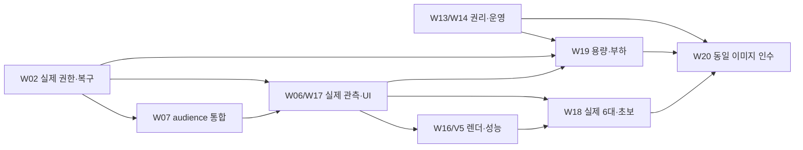

# MVP 잔여 작업과 다음 실행계획

기준: 2026-09-13의 재개 후 사용자가 요청한 **현재 작업 마감·계획 정리·중지**.
관련 Jira는 [S15P21C204-215](https://ssafy.atlassian.net/browse/S15P21C204-215)다.
이 문서는 [전체 실행계획](mvp-completion-plan.md)의 현재 잔여 작업을 구체화한다.
코드·MR·운영 버전의 최종 값은 [중단·재개 기록](mvp-resume-2026-09-13.md)과
[구현 기록](mvp-implementation-progress.md)에 기록한다. 이 계획을 작성한 것으로 다음 구현을
시작하지 않는다. 사용자가 다시 재개를 요청할 때 아래 순서로 진행한다.

## 1. 완료 목표와 현재 판단

목표는 **현재 주소의 팀원 SSO 제한을 유지하면서, 검증된 공개 대상 설정만 바꾸면 일반
이용자를 받을 수 있는 MVP**다. 실제 공개 전환은 하지 않는다. 도망자 아이템
MP-06·EQ-06·EQ-07·EQ-08·EQ-09·EQ-12와 아이템 전용 G3-C/G5 행동은 제외 상태를 유지한다.
술래 장비·구속·포획·포즈 탈출·지도 교환·얼굴·음성·재경기는 필수다.

게임의 기본 기능을 새로 만드는 단계는 지났다. 가장 큰 미완료는 공개 미디어의 전체 제품
인수, 공개 대상 설정 통합, 실제 시험 생산자, 실제 플레이·렌더링 품질, 운영·권리·용량이다.
현재 성공한 단위 시험이나 팀 모드 배포를 MVP 전체 또는 PUBLIC_READY로 계산하지 않는다.

| 구분           | 확인된 구현·증거                                                                | 남은 경계                                                                       |
| -------------- | ------------------------------------------------------------------------------- | ------------------------------------------------------------------------------- |
| 입장·진행      | 개인 체험, 게스트 서버 입장, 친구 초대, 방장 잠금/강퇴, 준비·결과·재경기 안내   | 동일 이미지의 ingress/릴리스 audience 전환, 제품 UI 전체 흐름, 신규 사용자 인수 |
| 입력·미디어 UI | 표본 수명/필터, 카메라·마이크 분리, 음량·음소거·품질 복원, 웹 분리 연결         | 실제 장치 튜닝, 서버의 공개 권한과 전체 제품 연결, 얼굴·음성 동시 인수          |
| 수명·운영      | 방 만료/회수, HTTP/감사 상한, 내구 기록 축약, 운영 검사 회복, 미세 시각 보정    | 아래 단일 모드 예약 공백, 미확인 전달 해소, 장기 부하, 외부 복원·경보           |
| 공개 미디어    | 분리 grant/예약/서버 전달, 실제 웹 어댑터 Cloud, 방 생성 전·재생성 후 토큰 거절 | 구성요소와 실제 GrantIssuer/HTTP/웹을 모두 연결한 승인, 지연·재시작 Cloud/G1    |
| 렌더링         | 시설 재질·조명·안개·몸/얼굴 보간·HUD 및 V5 도구                                 | 최종 장면 보완, 실제 공포감/가독성, 추론·5명 얼굴 동시 성능                     |
| 자산·인수 도구 | 7개 비전 모델 근거/고지, G5/종합 판정기 및 시간·중복 거절 보강                  | 손동작 분류 2구성·MediaPipe 번들 고지, 실제 관측 생산자와 인수 실행             |

과거 K03/K04 판정기 결함, K05/K06/K08/K09 화면 결함, 196 초안은 이미 후속 구현이 있다.
[이전 검토](mvp-plan-review-2026-09-13.md)는 발견 당시 근거로 보존하며 신규 미구현 목록으로
그대로 실행하지 않는다. [최신 기획서](spec/current.md)의 제품 목표와
[결정 정정표](spec/decisions.md)를 유지하고 실제 진행 상태는 이 문서와 구현 기록을 우선한다.

## 2. 실행 순서와 병렬 범위

| 순서 | 묶음                                | 선행                                       | 다음 단계로 넘어가는 조건                                           | 주관          |
| ---- | ----------------------------------- | ------------------------------------------ | ------------------------------------------------------------------- | ------------- |
| 1    | W02 미디어 내구 복구·실제 권한 인수 | 이번 D/R 마감 결과                         | 미확인 처리·발급/회수의 실제 제품 경계 입증, 합성 승인 주입 없음    | E, B/D/F 검토 |
| 2    | W07 공개 대상·릴리스 통합           | 비활성 코드는 1과 병행, 인수는 1 이후      | 동일 이미지 team→격리 public→team, 운영 주소 team 유지              | B/F, C/E      |
| 3    | W06/W17 관측 생산자·제품 UI         | 안정된 1/2 계약                            | G1/G4·제품 6화면·성능·부하 데이터가 실제 실행에서 생성됨            | F, B/C/D/E    |
| 4    | W13/W14 권리·개인정보·운영          | 1과 병행                                   | 실제 권리 근거·문의/보관 정책·외부 경보/복원, 미해결 운영 결함 정리 | F/E, C/D/제품 |
| 5    | W16/V5 장면 보완·통합 성능          | 기존 렌더러에서 병행, 최종 인수는 1/3 이후 | 대표 장면·정보 경계·중간 45fps/저사양 30fps 및 긴 프레임 평가       | C/D, A/F      |
| 6    | W08–12/W15/W18 실제 플레이          | 1/2/3, 최종 후보는 4/5 포함                | 실제 6대 5판·초보 그룹·역할 교환·복구와 재경기 인수                 | 전원, F 집계  |
| 7    | W19 용량·단계 부하                  | 1/3/4, 승인된 용량·예산                    | 1→3→5→10방, 실제 900초와 게임 단독 30분 각각 통과                   | F/E/B/A       |
| 8    | W20 같은 이미지 최종 리허설         | 1–7 모든 필수 결과                         | 인수·공개 준비·접속 대상 상태를 분리해 확인하고 운영 team 유지      | F/B/E/C       |

같은 파일을 여러 담당자가 동시에 수정하지 않는다. B 공통 계약, E 미디어/내구 기록,
F 설정·manifest·집계의 변경은 해당 생산자와 소비자를 같이 검토한다.

## 3. 첫 재개 묶음: W02를 실제로 닫기

### 3.1 이번에 마감하는 것과 아직 해결되지 않은 것

- [전달 내구 기록](split-forward-durability.md)은 실제 전송 전에 intent를 fsync하고,
  재시작 뒤에도 미확인 요청을 잃지 않게 한다. **안전 차단의 완료이지 서비스 복구 완료가 아니다.**
- [예약 내구 기록](split-reservation-durability.md)은 split의 예약 전 준비 기록, 부분 예약,
  서명 전 중단을 구분한다. 입증된 빈 예약만 ABORTED로 처리하며 원격 회수 REVOKED와 구별한다.
- 새 저널 필드/상태를 읽는 reader가 먼저 배포돼야 한다. 새 필드를 쓴 저장소를 구 reader로
  바로 되돌리는 rollback은 지원하지 않는다. 운영 split writer는 실제 승인 전 활성화하지 않는다.
- [방 재생성 검증](unjoined-media-revocation.md)은 실제 Cloud에서 새 SID·기존 토큰 거절·
  정상 대조군·정리를 통과했다. 같은 이름 방 생성의 120초 안정화는 해당 시험의 관측 조건이다.
  이 결과로 늦은 forward의 최종성이나 전체 제품 발급을 대신 입증할 수 없다.

### 3.2 남은 구현과 종료 기준

| 작업                         | 코드 근거·수정 방향                                                                                                                                                                                                                                                                                                    | 필수 검증·종료 기준                                                                                                                                             |
| ---------------------------- | ---------------------------------------------------------------------------------------------------------------------------------------------------------------------------------------------------------------------------------------------------------------------------------------------------------------------- | --------------------------------------------------------------------------------------------------------------------------------------------------------------- |
| 단일 모드 첫 예약 공백       | [MediaUsageLease](../server/src/operations/MediaUsageLease.ts), [ReadinessRuntime](../server/src/health/ReadinessRuntime.ts). 공유 방 lease의 첫 예약 fsync→첫 journal 사이에도 준비 owner를 복구할 수 있도록 설계                                                                                                     | 실제 파일로 첫 예약, 두 번째 사용자 합류, 선행 사용자 종료, 첫 서명 도중 강제 종료. 공유 ACTIVE 예약을 빈 ABORTED로 오인하지 않고 재기동 회수/정산까지 연결     |
| 미확인 forward의 해소        | [ForwardedMediaEdge](../server/src/media/ForwardedMediaEdge.ts), [OperationJournal](../server/src/operations/OperationJournal.ts), [RecoveryCleanupBindings](../server/src/operations/RecoveryCleanupBindings.ts). 공급자 최종 상태 또는 늦은 효과가 불가능함을 입증하는 경계를 정하고 원래 요청/세대와 묶어 내구 기록 | TTL/JWT 만료, 방 삭제, 단발 부재 조회만으로 해제하지 않는 부정 시험. 유효한 근거가 있을 때만 사용량·좌석·다음 세대를 여는 양성 시험. 증거 없는 운영자 삭제 금지 |
| 회수 전용 근거 포트          | 보존한 C 초안의 VerifiedRevocationBasis. 원문 bytes/hash/source/lock/project/관측 namespace·실측 clock과 현재 소유권을 확인                                                                                                                                                                                            | 다른 project/namespace, 변조/복제 근거, 소유권 상실 후 queued dispatch 거절. GrantIssuer/readiness의 전체 capability를 우회하지 않음                            |
| 실제 지연·종료 구성요소 시험 | 계획 중인 MC-PUBLIC-04. 실제 edge/journal/usage/recovery + 실제 Cloud transport, 제품 프로세스 종료                                                                                                                                                                                                                    | 응답 전달 지연 주입과 공급자 자체 지연을 구별. ACK를 받기 전 종료된 프로세스의 intent는 복원 후에도 보존. 원격 ACK·부재·정리와 미해결 차단 각각 실제 관측       |
| 전체 제품 권한 연결          | [MediaCoordinator](../server/src/media/MediaCoordinator.ts), [GrantIssuer](../server/src/media/GrantIssuer.ts), HTTP/session 바인딩과 웹 분리 연결                                                                                                                                                                     | 9개 SPLIT_AUTHORITY_CHECKS를 실제 근거에서 생성. 실제 입장→발급→두 연결→가청 전환→회수→재경기. 전체 SUPPORTED를 모두 true인 fixture로 주입하지 않음             |

미확인 해소 방식은 공급자가 보장하는 범위부터 확인한다. 1–2인일의 제한된 기술 검토에서
실제 최종성 근거를 얻지 못하면 실패 조건·게임/비용 영향·가능한 구조 변경을 기록하고 다른
독립 작업을 진행한다. 같은 불확실성을 반복 시험으로 덮거나 차단 조건을 완화하지 않는다.

### 3.3 다음 Cloud 시험을 실행하기 전

MC-PUBLIC-04는 **아직 하네스·allowlist·사전검사·호스트 실행을 완료하지 않았다**.
제안 경로는 `server/test/media/split-recovery.cloud.test.ts`, child는
`server/test/media/cloud/split-recovery-process.ts`다. 존재하는 파일로 오인하지 않는다.

- 실제 코드가 고정된 SHA와 lock hash, 프로젝트, 고유 QA namespace 및 이전 MC02/03 원문
  경로/hash를 대조한다. 과거 관측 namespace를 새 실행 namespace로 바꿔 쓰지 않는다.
- clock 오차는 기존 capability 시험처럼 실제 `createRoom.creationTime`과 요청 전후 시각에서
  상한을 측정한다. MC03이 측정하지 않은 값을 0으로 채우지 않는다.
- 제안 상한은 3방, 원본 SDK 4개/최대 물리 자원 8개, JWT 4개·300초, 정상 240초+
  정리 120초, 예약 50 participant-minutes/400MB다. 정상 API 40회/정리 60회, 60초 총 100회
  내에서 child·부모·재시도·finally 호출을 합산한다. **구현 전 계산안이며 승인된 실행 결과가 아니다.**
- 최신 대시보드 잔량과 quota를 다시 확인한다. CI/배포/다른 Cloud 시험과 겹치지 않게 하고,
  키는 기존 서버에서만 사용한다. 단계 실패 시에도 제한된 제거 ACK·부재·방 정리를 기록한다.
- 구성요소 proof와 최종 제품 인수 proof를 분리한다. 진단 signer 사용은 실제 제품 발급
  통과로 계산하지 않는다. 검사 실패·정리 실패·잔량 미확인이면 다음 단계로 올라가지 않는다.

## 4. 공개 대상과 실제 시험 도구

### W07: 단일 audience의 배포 통합

`SERVICE_AUDIENCE=team|public`과 게스트 입장은 구현돼 있다. 남은 것은
[host.conf](../infra/nginx/host.conf), 배포 설정, [release-sequence](../scripts/lib/release-sequence.mjs)의
같은 설정 선택 및 검증이다. 현재 public+LiveKit 부팅 차단은 W02 인수 전에 제거하지 않는다.

동일 이미지의 격리 public에서 GitLab 계정 없는 6개 세션이 생성·초대·완주·재경기를 진행하고,
team 복귀 뒤 일반 신규 입장은 차단돼야 한다. 양쪽 모드에서 위조 SSO 헤더·만료/회수/타방
토큰·중복 좌석·정원 초과를 거절한다. Jenkins/운영 API/후보 서버/백엔드 포트는 계속 보호한다.
ingress와 서버의 모드 불일치·누락이면 승격을 거절한다. 운영 도메인의 제한을 잠깐 풀어 시험하지 않는다.
public→team의 기존 게스트 연결도 확정한 drain/종료 정책에 따라 정리하고, 신규 입장 차단과
기존 연결 종료·미디어 회수·좌석 반환을 모두 확인한다.

### W06/W17: 검사 함수에 실제 관측 연결

| 사례       | 남은 구현                                                                                                                                      | 종료 기준                                                                        |
| ---------- | ---------------------------------------------------------------------------------------------------------------------------------------------- | -------------------------------------------------------------------------------- |
| G1 A/B/C/D | [시험 안내](testing.md)의 지연 allow/deny, 강제 종료/재기동, SID 교체, 미입장/옛 토큰·직접 구독 연결                                           | 정상 수신 양성 대조와 금지 수신 대조, 실제 표식/시각·같은 source·정리 결과       |
| G4         | metadata뿐 아니라 실제 개인 뷰·얼굴/음성·장식·그림자와 공개 전송 대조                                                                          | 술래 출구·미탐색 지형·시야 밖 위치가 전송/표시/음향에 누출되지 않음              |
| 제품 UI    | [mvp-flow](../tests/cloud/mvp-flow.cloud.test.ts)에 실제 제품 0.2의 6개 화면 연결                                                              | 초대→장치→연습→경기→개인/팀 결과→재경기. 진단 로비/HTTP stub만으로 통과하지 않음 |
| 성능       | [performance](../tests/cloud/performance.cloud.test.ts)에 실제 GPU·카메라 3모델·R3F·160×160 얼굴 업로드·상대 5트랙 연결                        | 대표 장치별 FPS/긴 프레임/입력 지연/메모리·반복 경기 자원 관측                   |
| 부하       | [MediaLoadScenario](../tests/load/MediaLoadScenario.ts), [TenRoomSchedule](../tests/load/TenRoomSchedule.ts)의 비용/세션 모델과 실제 수집 연결 | 논리 게임 세션, SDK 연결, 전달 복제, 공급자 물리 참가자와 API/바이트를 별도 집계 |

이미 고친 G5·종합 판정기와 rolling 900초/중복 거절을 다시 새로 만들지 않는다.
BLOCKED 시험을 실제 행동·관측 생산자로 교체하되 상수 PASS나 fixture를 최종 증거로 쓰지 않는다.
현재 ProductApp은 WorldCanvas의 측정 callback을 연결하지 않으므로 실제 제품의 비전/렌더/
WebRTC 타임라인 수집을 먼저 연결한다. 원본 얼굴·음성을 저장하지 않고 표식과 수치로 검증한다.
시설 E2E의 스크린샷 저장·자원 수 검사는 자동 이미지 비교나 공포감 평가를 대신하지 않는다.

## 5. 렌더링과 실제 플레이 완성

### W16/V5: 기존 시설 렌더러의 최종 보완

기존 [시설 렌더링](rendering-facility.md), [WorldCanvas](../apps/web/src/features/game/scene/WorldCanvas.tsx),
[FaceAvatar](../apps/web/src/features/game/scene/FaceAvatar.tsx)를 사용한다. V0–V4를 처음부터
재제작하는 공수로 계산하지 않는다.

1. 실제 제품에서 직선 복도·코너 마주침·자기 출구/장비의 대표 장면을 고정한다.
   4방향 벽·접합부·막다른 길·출구 접근이 서버 통행/충돌과 일치하는지 비교한다.
2. 밝기만 낮추지 않고 바닥/벽 대비·국소 조명·재질·안개를 다듬는다. 회전 중 벽 관통,
   잘림·셀 등장 튐·얼굴과 몸의 어긋남·시야 밖 잔상을 검사한다.
3. 감지기/덫 상태, 구속/포획/탈출, 자기 목표와 HUD를 구별한다. 공포 연출이 비공개
   위치/역할을 드러내거나 입력/판정 기한을 바꾸지 않게 한다.
4. 카메라 추론·자기 얼굴 게시·원격 얼굴 5개·근거리 음성·HUD를 함께 실행한다.
   중간 평균 45fps, 저사양 30fps와 긴 프레임·입력 지연·반복 경기 자원 증가를 기록한다.
5. 같은 장면의 변경 전후와 신규 플레이어 평가를 비교한다. 무서운 순간, 너무 어두운 곳,
   상대 위치 오해, 멀미/불편을 분리해 수정한다. 코드/정지 이미지로 체감 인수를 대신하지 않는다.

### W08–12/W15/W18: 실제 6대와 초보 인수

개인 체험·행동 안내·모션 필터·음량·명단/결과는 이미 연결돼 있다. 남은 것은 실측과 결함
수정이다. A/D는 횡이동이 아닌 90도 회전이라는 기존 규칙을 기준으로 안내·조작을 확인한다.

- 대표 PC/브라우저/카메라 6대의 OS/GPU·해상도·입력 모드·네트워크·source를 기록한다.
  초기 결함 탐색과 최종 렌더링 후보 인수를 각각 약 90분으로 확보한다.
- 정상 5판에는 이동/교환/2명 탈출, 역할 교환/술래 장비/2명 포획, 180초 방어와 재경기,
  방장 위임/1명 교체, 장치 단독 상실·재보정 후 완주를 배분한다.
- 3개 포즈·키 대체·자연 만료/면역·개인 종료 후 남은 경기·지도/장비 초기화·중복 오디오·
  퇴장 뒤 자원 해제를 포함한다. 게임 소켓 상실 등 강제 중단 사례는 정상 5판과 별도다.
- 중립 60초 오입력, 의도한 전후/좌우 반복 성공률·지연, 보정 재시도와 카메라 조건을 측정한다.
  얼굴 안경/역광/회전/가림·추론 정체·탭 이탈에서 안내와 안전 전환을 확인한다.
- 초보 2그룹에서 체험 진입·보정·첫 경기·재경기를 관찰한다. 체험 1분, 보정 2회 이내,
  6명 입장 후 5분 내 시작은 초기 목표안이며 표본 조건과 평가 기준을 먼저 고정한다.
- 역할 교환 포함 추가 약 20판으로 억울한 판정·승리 편향을 탐색한다. 작은 표본을 통계적
  공정성 확정으로 표현하지 않는다. 튜닝 후 관련 G3와 실제 플레이를 다시 확인한다.

## 6. 권리·운영·용량의 공개 차단 요인

### W13/W14: 실제 운영에 필요한 근거

- `gesture_embedder.tflite`, `canned_gesture_classifier.tflite`의 배포 허용/고지와
  `@mediapipe/tasks-vision` 번들의 구성요소 고지를 확인한다. 모델 카드에 라이선스가 없거나
  npm 메타데이터가 Apache-2.0이라는 사실만으로 각 바이너리 권리를 확정하지 않는다.
  214에서 완료한 7개 모델 고지는 유지한다. 추가 조사 근거는 중단 기록에 남긴다.
- 렌더 자산·음원·폰트의 출처/버전/허용 조건·고지를 제품 자산 대장과 연결한다.
- 장치 사용 전 얼굴 가공/전송·음성·사전 수신과 출력 제어·저장/보관/삭제·문의 경로를
  실제 코드와 맞춘다. 가공 얼굴을 익명화라고 안내하지 않는다. 실제 운영자·문의처를 임의 작성하지 않는다.
- 외부 감시에서 서버 사망/LOCKED/429/저널 실패/회수 미확인과 회복 알림을 실제 수신하고
  중복 억제를 확인한다. 화면/로그에 알림이 남는 것과 담당자 전달 성공을 구별한다.
- 호스트 외부 백업을 별도 볼륨에 복원해 단일 writer·구세대 회수·좌석 반환·READY까지
  확인한다. 같은 호스트 복사본만으로 외부 복원을 완료 처리하지 않는다.
- 이미지 취약점은 실제 사용 경로·수정 가능성을 검토한다. 예외에는 근거·담당·기한을
  붙인다. 재경기 뒤 입장503은 원인이 미확정이므로 재현/진단·관련 반복 흐름으로 별도 추적한다.

### W19: 용량 계산을 먼저 바로잡고 단계 부하 실행

마지막 관측 Build 한도는 동시 참가자 100이었다. 다음 실행 때 다시 확인한다.
6인 split 한 경기는 SDK 원본 연결 12개, 현재 보수적 자원 예약은 최대 72개다.
10방은 원본만 120개이며 현재 100 한도에서는 목표를 만족할 수 없다. 현 예약 기준으로는
완전한 6인 두 경기의 동시 준비부터 제한된다. 복제의 실제 quota/청구 반영과 회수 중 점유도
확인해야 하며, 설정 숫자만 올리거나 목표를 줄여 통과시키지 않는다.

현재 부하 도구는 6논리 세션/방과 60×15분=900 participant-minutes를 기본으로 계산한다.
논리 60명 목표는 유지하되 split 연결/복제까지 반영한 예약·실측 비용 모델을 먼저 수정한다.
quota·과금 상한·시험 프로젝트가 정해진 뒤 아래를 진행한다.

1. 실제 Cloud 미디어 포함 1→3→5→10방. 낮은 단계 실패·미해결 회수·429·예산 불확실성이면 중단.
2. 같은 10방·60게임 세션의 비중복 유효 900초를 확보한다. SDK 연결 수는 별도 기록한다.
   관측 공백·중복 창·세션 감소·파괴 구간으로 정상 시간을 채우지 않는다.
3. 정상 API ≤600회/60초, 429=0, 정책 지연 p95≤500ms/p99≤1초,
   Tick p95≤20ms/p99≤40ms, event-loop p95≤20ms, 시험 네트워크 명령 수용 p95≤200ms.
4. 게임 전용 60클라이언트 30분은 WebRTC 15분과 분리한다. 10,000회 요청/반복 방 수명의
   컬렉션 상한·메모리 추세·내구 기록 축약·재기동과 최종 잔존 자원 0을 확인한다.

## 7. 결정·외부 자원 대기 목록

지금 사용자에게 추가 질문을 보내거나 값을 임의 확정하지 않는다. 다음 실행에서 해당 단계의
독립 구현을 먼저 끝내고 필요한 실제 정보가 없는 경우에만 해당 인수를 대기 상태로 둔다.

| 필요한 값/자원                                      | 필요한 이유                               | 값 없이 가능한 일                                            |
| --------------------------------------------------- | ----------------------------------------- | ------------------------------------------------------------ |
| Cloud 복제 과금/동시 quota, 유료 한도·시험 프로젝트 | split 10방의 물리 용량과 비용 승인        | 세션/자원 모델·예산 거절·계측 도구, 현재 상한 내 작은 시험   |
| 지원 PC/브라우저/카메라 6대와 참가 시간             | G5·성능·모션·얼굴·음성 실제 인수          | 시나리오·수집기·UI 회귀·장면 보완                            |
| 초보 2그룹과 역할 교환 표본                         | 이해도·공포감·밸런스                      | 질문/평가 기록 양식·규칙 회귀                                |
| 실제 문의 담당/주소·보관 정책                       | 개인정보 안내와 이용자 대응               | 코드 데이터 흐름 조사·안내 초안·설정 검증                    |
| 경보 수신자/채널, 외부 저장소, RPO/RTO·지원 시간    | 경보 전달·백업/복원의 현실적 완료 조건    | 전송/복원 도구·재시도/중복 억제·실패 시나리오                |
| 남은 모델/번들의 공식 권리 근거                     | 공개 자산 배포 승인                       | 공개 출처 재확인·자산 대장. 필요하면 합법적 대체안 영향 산정 |
| 공급자의 늦은 forward 최종성 근거                   | 미확인 intent의 안전한 해소와 서비스 재개 | 부정 시험·내구 상태·운영 진단, 근거 없는 unlock 방지         |

게임 소켓 상실은 현행 경기 무효/재모집 정책을 유지한다. 인증 재접속, 모바일, 봇, 매칭,
랭킹, 영구 전적, 추가 맵은 이번 부족분에 조용히 추가하지 않는다.

## 8. 다음 재개 절차와 작업량 관리

1. 최신 develop·미커밋 변경·MR·Jira·배포 source/last-good/READY를 대조한다.
   보존된 C 초안을 먼저 확인하고 새 작업트리를 만들어 중복 구현하지 않는다.
2. 215의 남은 완료 조건을 읽고 W02의 단일 모드 공백/미확인 해소 설계/회수 근거 초안부터
   검토한다. 안전한 reader와 생산자 연결, 실제 구성요소 proof, 전체 제품 인수 순서로 묶는다.
3. 독립적인 W07 비활성 구성, W06 관측 도구, W13/W14 정보 정리, 렌더 장면 작업을 소유권에
   맞게 병행한다. 실제 선행 승인 없이 공개 미디어를 켜지 않는다.
4. 한 문제당 MR을 강제하지 않는다. 실제 Jira를 재사용하거나 범위에 맞게 생성하고, 통합
   가능한 묶음은 한 MR로 검증한다. 깨진 초안을 배포하거나 미통합 상태를 완료로 닫지 않는다.
5. 변경 경계의 회귀→최종 묶음 `pnpm verify`→정확한 소스의 CI→병합→실제 배포 확인 순서다.
   같은 코드의 전체 검사를 근거 없이 반복하지 않는다. 대체된 소스의 대기 CI는 확인 후 취소한다.
6. 각 묶음마다 소스/검사/미검증/다음 시작점을 갱신한다. 장치·외부 근거가 필요하면 미완료를
   유지하고 다른 독립 작업을 진행한다. 사람/장비 대기를 자동으로 통과시키지 않는다.

과거 전체 50.5–85인일 추정을 잔여 공수로 재사용하지 않는다. 남은 일은 위 8개 묶음이며,
W02 최종성·10방 quota·실제 참가자 확보가 납기를 크게 좌우한다. 첫 W02 proof가 끝난 뒤
구현 시간, 자동 CI/배포 시간, 외부 자원 대기를 나눠 다시 산정한다. 완료율을 테스트 개수나
MR 개수로 환산하지 않는다.

## 9. 최종 완료 증거

- [ ] 확정 범위의 G3 기능 회귀와 실제 제품 6화면 흐름.
- [ ] 실제 G1 권한·G4 정보 경계, 재시작/미확인 해소·발급/회수의 전체 제품 연결.
- [ ] 실제 6대 정상 5판, 초보·모션·얼굴/음성·역할 교환·최종 렌더 인수.
- [ ] 권리·개인정보·문의·외부 경보·외부 백업 복원·취약점/운영 결함 정리.
- [ ] split 비용 모델·승인된 용량에서 단계 부하, 같은 10방 900초와 게임 전용 30분.
- [ ] 동일 이미지 team→격리 public→team 리허설과 내부 운영 경계 보호.
- [ ] source/lock/hash/환경/장치/날짜·양성/금지 대조·정리가 일치하는 실제 증거.
- [ ] 최종 판정은 기능 인수, 공개 준비, 현재 팀원 접속 제한을 구분하며 운영은 team 유지.

현재 판정기의 실제 필드는 `mvpComplete`, `release.ready`, `publication.allowed`다.
team에서는 실제 일반 공개 허용이 false인 것이 의도된 결과다. CLI exit 0만으로 최종 상태를
결정하지 않고 기능 인수/운영 준비와 실제 공개 차단 이유를 각각 확인한다.

미실행·BLOCKED·진단 signer·합성 장치·옛 SHA를 실제 인수로 바꾸지 않는다.
모든 항목을 충족한 뒤에야 공개 시점과 검증된 대상 설정 전환만 남았다고 보고한다.
