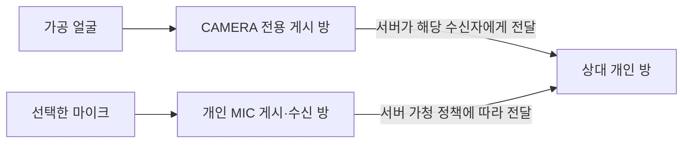

# 공개 미디어 제품 연결

Jira [S15P21C204-215](https://ssafy.atlassian.net/browse/S15P21C204-215).
시작 develop `f79726c4`, 선행214/!138 병합 `1cb41f05` 동기화.
현재 단계는 웹 연결·게시·바인딩 소비자와 실제 Cloud 시험 도구다.
공개 서버의 세대 발급·내구 회수·사용량 생산자는 아직 미통합이며 팀 모드를 유지한다.

## 연결 계약

`server-forwarding` grant는 개인 음성 게시/수신 방을 기본 연결로 사용한다.
`facePublication`은 같은 URL과 만료 시점의 CAMERA 전용 게시 연결이며 방·신원·토큰은
기본 연결과 다르다. 필드 누락·단일 모드에 혼합·같은 방/신원/토큰·다른 URL은 거절한다.
서버 HTTP의 공개 parser와 웹 MediaSession이 같은 조건을 검사한다.
공통 타입·fixture·역할별 사본과 서버/웹의 구조 타입을 함께 갱신했다.

개인 방은 서버가 전달한 트랙을 자동 구독한다. 얼굴 게시 방의 자동 구독은 꺼져 있으며
토큰의 canSubscribe=false는 서버가 보장해야 한다. 자동 구독 설정 자체는 권한 증거가 아니다.
`MediaBinding.facePublisher`는 해당 수신 방에서 확인한 얼굴 게시자 신원/SID다.
얼굴은 이 SID, 음성은 기존 participantSid와 대조한다. 얼굴 게시자 SID가 바뀌면
같은 trackSid/세대라도 기존 화면 부착을 해제한다. metadata나 nickname으로 추측하지 않는다.

기존 단일 grant와 내부 publisher-permissions 입력은 계속 지원한다. 새 모드의 계약은
새 웹·서버를 함께 사용해야 한다. 구 parser는 알 수 없는 필드를 거절하며, 이번 코드로
현재 제품 서버가 새 grant를 발급하거나 공개 audience가 READY로 바뀌지는 않는다.

## 웹의 수명과 게시

실제 `InteractionRuntime → MediaSession → LiveKitAdapter`에서 새 모드를 선택한다.
두 SDK 연결 모두 완료된 후에만 연결 성공·게시·원격 트랙 전달을 허용한다.

- CAMERA는 얼굴 방, MIC는 개인 방에만 게시한다. 교체·해제·송출 bytes 조회도 원래 연결을 따른다.
- 한 연결 실패/종료 시 다른 연결도 닫는다. 오래된 연결/게시 완료는 다시 해제하며 현재 상태로 되살리지 않는다.
- 재연결 중 한쪽만 복구돼도 성공으로 보고하지 않는다. 세대 교체의 이전 callback은 현재 세대에 적용하지 않는다.
- SDK disconnect/unpublish에 stop=false, 소스 교체에 userProvidedTrack=true를 전달한다. 원본 장치 종료는 기존 D 수명 관리가 맡는다.
- 로컬 SDK 해제와 서버의 토큰 회수·원격 부재 확인은 별개다. 서버의 미확인 회수를 이 결과로 성공 처리하지 않는다.

## 검증 상태

관련6파일90개와 루트 타입 검사를 통과했다. 두 연결 지연/실패, 부분 복구, 종료 후 늦은 성공,
늦은 게시, 가공 얼굴/마이크 경로, 원본 장치 보존, 바인딩 교체와 잘못된 grant 거절을 포함한다.
첫 관련 검사에서 계약 시험의 package 루트 import가 실패했다. 실제 공개 export인
`@kkakkung/protocol/game-messages`로 수정한 후 통과했다. 단위 시험의 미디어는 합성 객체다.
계약 fixture33/도구11 통과는 실제 Cloud 또는 제품 권한 인수가 아니다.

MC-PUBLIC-02는 두 브라우저에서 실제 제품 어댑터로 네 SDK 연결을 만든다.
기존의 얼굴 유지·음성 차단·동일 목적지 재허용·서버/SID 대조·정리에
`productTransportUsed` 확인을 추가했다. 토큰은 시험 생산자가 발급하고 서버 전달도
한정된 진단 시나리오가 수행한다. 제품 서버 생산자까지 연결한 시험으로 확대 해석하지 않는다.
첫 단계의 `pnpm verify`는254파일·2,614개·22 E2E(58.5초), 포맷·계약33/도구11·
lint·루트 타입·빌드·실제 Worker/자산 검사를 통과했다. 앞선 lint의 시험용 미사용 변수2개는
제거했다.

2026-09-13 19:20:30–19:20:56 KST, 깨끗한 소스
`8e11d0b1db5891d915eb6081f2a3e957650579b4`로 실제 MC-PUBLIC-02를 통과했다.
`product-split-adapter`의 두 페이지/네 SDK 연결, 합성 Canvas/오실레이터를 사용했다.
시험23,967ms/exit0, 정상15·정리16호출, 위 열 조건 모두 true다.
얼굴/음성/재허용 음성의 원본·전달본 SID가 같은 것으로 관측됐고 최종 참가자·방 부재를 확인했다.
허용 약267ms·재허용263ms·차단과2초 안정 구간 확인2,359ms다. G1의1초 차단 인수는 아니다.
`splitTransportVerified=true`, `productPublicReady=false`, `promotionAllowed=false`다.

호스트 격리 checkout `split-runtime-215a-20260913-8e11d0b1` 아래
`.local/qa/split-media-1789294830288`에 증거를 보존했다.
namespace는 `qa-public-20260913-e4d77cb1`이며 운영 게임 자원을 사용하지 않았다.
19:14 KST에 Build 포함5,000분 중313분·50GB 중약1GB 사용, 동시100참가자·
API10,000/분을 확인했다.3방/8참가자·50분/400MB·정상40/정리30호출 상한을 유지했다.

| 증거                      | SHA-256                                                            |
| ------------------------- | ------------------------------------------------------------------ |
| pnpm-lock.yaml            | `469b418cc3a6d656d9f5ea61292d3e7801b5b7bcfc89af3bec29580342944fdf` |
| preflight.json            | `37e8214390e87649ffb6c73713049542482e2cc7436a0fca0d9c2526d56f18bc` |
| devices.json              | `1b2be368e2e7c8b05fd5689200ab05d792e125c87d33f6034f80d46c9e66c95e` |
| run-summary.json          | `667d672d85a8140bf58939446d907373d5fa76f3e19b6aa5e8268cfa98c5f953` |
| split-media-evidence.json | `48a48717a63c90dfa3f5762f78eac60cfbc95c77b9af8af9a5e7c26b019972d9` |

이 결과는 제품 웹의 전송 소비자를 사용하지만 발급·전달·정리 생산자는 진단 실행기다.
제품 서버 수명·실장치·전체 G1·부하의 통과로 계산하지 않는다. 후속 문서 커밋은 위 소스와
앱 코드가 같으며 CI·MR·배포 결과는 각각 확인 후 [구현 기록](mvp-implementation-progress.md)에 기록한다.

## 다음 구현 경계

1. 서버 세대가 두 원본과 모든 전달 목적지를 소유하도록 예약·원자적 기록·최소 권한 발급을 연결한다.
2. 서버 권위 가청 정책과 새 SID 대조를 전달/제거에 연결하고 timeout·늦은 allow·부분 실패를 닫는다.
3. 토큰 원본·갱신·미입장, 원본/복제 참가자 회수와 재기동·사용량·readiness를 통합한다.
4. 실제 제품 HTTP/Room/Runtime의 제한된 Cloud 시나리오를 통과한 뒤 W06의 전체 G1로 이어간다.

첫 웹 전송 단계는 !139·CI #118/GitLab #191675를 통과해 `674631b3`에 병합했다.
다음 [서버 회수 단계](split-media-recovery.md)는 새 소유 기록의 reader와 실행 중/재기동 회수부터
연결한다. 세대 할당·grant 서명·가청 전달·사용량 생산자 완료를 의미하지 않는다.

현재100참가자 한도에서10경기의 SDK 연결만120개다. 복제의 quota/요금 산정과 실제 상한은
[기존 실측과 용량 조건](split-media-proof.md)에 따라 확인한다. 한도 구매·목표 축소·공개 전환은
실행하지 않았다. 실제6대/전체 G1/10방·동일 이미지 전환 인수는 별도다.
