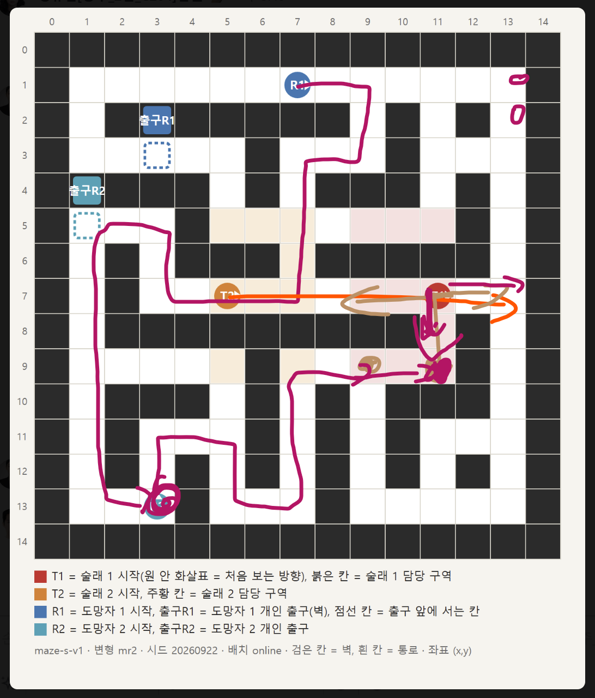

# 4. 시연 시나리오

발표에서 시연 방(`/showcase`, 2:2)으로 진행하는 순서다. 맵은 소형(15×15) `maze-s-v1` 변형 mr2, 시드 20260922로 고정이고, 자리마다 시작 칸과 출구가 매번 같다.

그림 범례: T1 = 술래 1 시작(원 안 화살표 = 처음 보는 방향), 붉은 칸 = 술래 1 담당 구역. T2 = 술래 2 시작, 주황 칸 = 술래 2 담당 구역. R1 = 도망자 1 시작, 출구R1 = 도망자 1 개인 출구(벽), 점선 칸 = 출구 앞에 서는 칸. R2 = 도망자 2 시작, 출구R2 = 도망자 2 개인 출구. 검은 칸 = 벽, 흰 칸 = 통로, 좌표 (x, y).

**좌표·방향 읽는 법**

- 좌표는 맵 그림과 같은 (x, y)입니다.
- 위쪽이 북쪽입니다. 북쪽으로 가면 y가 줄어듭니다.
- 조작은 몸동작이 기본이고, 괄호 안은 키보드 대체입니다.
  - 몸을 앞으로 기울이면 한 칸 전진합니다(W).
  - 고개를 좌우로 돌리면 90° 회전합니다(A / D).

**참가자와 시작 위치**

| 자리          | 시작 칸          | 역할                                                         |
| ------------- | ---------------- | ------------------------------------------------------------ |
| 도망자 1 (R1) | (7,1), 동쪽을 봄 | 탐색 → R2 출구 발견 → 하이파이브 → 장치를 밟고 포획됨 → 관전 |
| 도망자 2 (R2) | (3,13)           | R1과 하이파이브 → 자기 출구에서 포즈 → 탈출                  |
| 술래 2 (T2)   | (5,7)            | 감지기·덫 설치 → 구속된 R1 포획                              |
| 술래 1 (T1)   | (11,7)           | 길을 비켜 대기. 감지기 경보를 받는 화면을 보여 줌            |

---

### ① 입장 화면 `/showcase`

| 순서 | 누가             | 실행(클릭 위치)                                                                       | 화면 설명                                                                                                                     |
| ---- | ---------------- | ------------------------------------------------------------------------------------- | ----------------------------------------------------------------------------------------------------------------------------- |
| 1    | 4명 모두         | 브라우저에서 `/showcase` 접속                                                         | SSO에 로그인된 상태여야 합니다. 상단에 "발표 시연 · 시연 방 입장"이 뜨고, 2:2, 16x16 고정 맵, 3분 진행이라는 안내가 나옵니다. |
| 2    | 각자             | 가운데 **"내 자리"** 라디오에서 자기 자리(도망자 1 / 도망자 2 / 술래 1 / 술래 2) 클릭 | 이미 누가 고른 자리면 "그 자리에는 이미 누가 앉았습니다…" 문구가 뜹니다.                                                      |
| 3    | 방장 → 나머지 순 | 하단 **"시연 방 입장"** 버튼 클릭                                                     | **가장 먼저 들어온 사람이 방장(♛)이 됩니다.** 방장은 끝까지 나가지 않습니다. 방장이 나가면 방이 해체됩니다.                   |

### ② 대기실

| 순서 | 누가     | 실행(클릭 위치)                                                                    | 화면 설명                                                                      |
| ---- | -------- | ---------------------------------------------------------------------------------- | ------------------------------------------------------------------------------ |
| 4    | –        | –                                                                                  | 제목은 "시연 참가자를 기다리는 중"이고, `4/4 \| 준비 0/4` 인원이 표시됩니다.   |
| 5    | 4명 모두 | **"준비하기"** 클릭 → "카메라 사용 동의" 창의 체크박스 2개 → **"동의합니다"**      | 카메라 확인 단계로 넘어갑니다.                                                 |
| 6    | 4명 모두 | 안내대로 가만히 서기 → "몸을 앞으로 기울여 보세요" → "고개를 왼쪽으로 돌려 보세요" | "확인 완료"가 뜨면 준비가 끝납니다. 이 단계에서 몸동작 조작 방식을 설명합니다. |
| 7    | 방장     | `준비 4/4`가 되면 **"게임 시작"** 클릭                                             | "게임 시작" 버튼은 방장 화면에만 나옵니다.                                     |

### ③ 팀 연습 → 로딩

| 순서 | 누가     | 실행                                                                                                                         | 화면 설명                                                                                               |
| ---- | -------- | ---------------------------------------------------------------------------------------------------------------------------- | ------------------------------------------------------------------------------------------------------- |
| 8    | 4명 모두 | 왼쪽 연습 과제를 수행합니다. 앞·뒤·좌·우는 모두 하고, 도망자는 E, 술래는 F를 추가로 합니다. 끝나면 **"연습 준비 완료"** 클릭 | 모두 준비하거나 최대 60초가 지나면 다음으로 넘어갑니다.                                                 |
| 9    | –        | –                                                                                                                            | "경기를 준비하고 있어요"(미로 준비 → 화면·연결 확인 → 시작)가 뜨고 3초 카운트다운 뒤 경기가 시작됩니다. |

**경기 화면 구성**

- 상단 가운데: 3:00 시계. 그 아래 "도망자 · 도망자 1" 같은 역할 표시.
- 오른쪽 위: 내 캐릭터 창(내 얼굴 카메라).
- 가운데: 조준점과 그 아래 키 안내 줄.
- 하단 가운데: 아이템 슬롯.
- 오른쪽 아래: 미니맵. M 키로 전체 지도를 열고 닫습니다.
- 3D 캐릭터 얼굴에 각자의 카메라 얼굴이 입혀집니다.
- 목소리는 5칸 안에 있는 사람끼리만 들립니다.

### ④ 경기 ― 탐색과 장치 설치 (동시에 진행)

**R1: 도망자 2의 출구 찾기**

| 순서 | 실행(동작 / 키)                                                                           | 화면 설명                                                                                                         |
| ---- | ----------------------------------------------------------------------------------------- | ----------------------------------------------------------------------------------------------------------------- |
| 10   | 동쪽으로 2칸 가서 (9,1) → 오른쪽으로 돌아 남쪽 2칸 (9,3) → 오른쪽으로 돌아 서쪽 2칸 (7,3) | 걸어간 곳이 미니맵에 채워집니다.                                                                                  |
| 11   | 왼쪽으로 돌아 남쪽 4칸 (7,7) → 오른쪽으로 돌아 서쪽 4칸 (3,7)                             | T2가 이미 동쪽으로 떠나 비어 있는 7행을 지나갑니다.                                                               |
| 12   | 오른쪽으로 돌아 북쪽 2칸 (3,5) → 왼쪽으로 돌아 서쪽 2칸 (1,5)                             |                                                                                                                   |
| 13   | (1,5)에서 **오른쪽으로 돌아 북쪽 벽 (1,4)를 바라봄**                                      | **도망자 2의 출구 발견.** R1 미니맵에 R2 출구가 회색으로 표시됩니다. 자기 출구는 금색이고 남의 출구는 회색입니다. |
| 14   | 뒤로 돌아(두 번 회전) 남쪽 8칸 (1,13) → 왼쪽으로 돌아 동쪽 1칸 (2,13)                     | R2가 서 있는 (3,13) 바로 옆에 도착합니다.                                                                         |

**T2: 감지기와 덫 설치**

| 순서 | 실행(동작 / 키)                                                                | 화면 설명                                                                                                                                                  |
| ---- | ------------------------------------------------------------------------------ | ---------------------------------------------------------------------------------------------------------------------------------------------------------- |
| 10'  | 시작하자마자 동쪽으로 6칸 (11,7) → 남쪽 2칸 (11,9) → 서쪽 2칸 (9,9)            | 같은 편끼리는 서로 길을 막지 않아 T1 칸을 지나갈 수 있습니다.                                                                                              |
| 11'  | (9,9)에서 북쪽 벽을 바라보고 **`1`로 "▣ 감지기" 선택 → F**(또는 V 사인)로 설치 | 안내 문구는 "▣ 감지기를 여기에 설치할 수 있어요 · F"입니다. 0.5초 동안 가만히 있으면 벽에 붙고 1초 뒤 켜집니다. **도망자가 (9,9) 칸에 들어오면 울립니다.** |
| 12'  | 동쪽 2칸 (11,9)로 이동 → **`2`로 "▲ 덫" 선택 → F**                             | 덫은 서 있는 칸 바닥에 놓입니다.                                                                                                                           |
| 13'  | 북쪽 2칸 (11,7)로 올라가 **남쪽을 보고 대기**                                  | 여기서 R1이 오기를 기다립니다.                                                                                                                             |
| –    | T1: 시작 후 서쪽 (9,7)쪽으로 비켜서 대기                                       | T1은 감지기 경보를 받는 화면을 보여 주는 역할입니다.                                                                                                       |

### ⑤ 하이파이브로 지도 합치기

| 순서 | 누가      | 실행(동작 / 키)                                  | 화면 설명                                                                                                                                |
| ---- | --------- | ------------------------------------------------ | ---------------------------------------------------------------------------------------------------------------------------------------- |
| 15   | R1        | (2,13)에서 R2를 바라보고 **E**(또는 손바닥 펴기) | 안내 줄에 "E 지도 교환 요청"이 뜹니다. 같은 칸이나 상하좌우 옆 칸에 있어야 하고 대각선은 안 됩니다.                                      |
| 16   | R2        | **4초 안에 E**(또는 손바닥 펴기)                 | 안내 줄은 "E 지도 교환 수락"입니다. 두 사람이 탐색한 지도가 합쳐집니다. **R2 미니맵에 R1이 찾은 자기 출구 (1,4)가 금색으로 나타납니다.** |
| –    | 술래 화면 | –                                                | 1초 뒤 술래 미니맵에 교환 흔적(원)이 2초 동안 보입니다.                                                                                  |

### ⑥ R1: 감지기 → 덫 → 포획

| 순서 | 누가 | 실행(동작 / 키)                                                                                                             | 화면 설명                                                                                                                                                                                                                   |
| ---- | ---- | --------------------------------------------------------------------------------------------------------------------------- | --------------------------------------------------------------------------------------------------------------------------------------------------------------------------------------------------------------------------- |
| 17   | R1   | 동쪽 (3,13) → 북쪽 2칸 (3,11) → 동쪽 2칸 (5,11) → 남쪽 2칸 (5,13) → 동쪽 2칸 (7,13) → 북쪽 4칸 (7,9) → 오른쪽으로 돌아 동쪽 | R2 칸은 같은 편이라 그대로 지나갈 수 있습니다.                                                                                                                                                                              |
| 18   | R1   | (8,9)를 지나 **(9,9) 진입**                                                                                                 | **감지기가 울립니다.** 술래 2명 화면에 "▣ 감지기 작동 · ○○쪽 약 N칸" 배너가 3초 동안 뜨고, 번쩍임과 경보음, 미니맵 표시가 따라옵니다. 이때 **T1 화면을 보여 줍니다.** 6칸 안의 도망자에게는 "감지기가 울렸습니다"가 뜹니다. |
| 19   | R1   | (10,9)를 지나 **(11,9) 진입**                                                                                               | **덫이 발동합니다.** "⛓ 덫을 밟았습니다! N초 동안 움직일 수 없습니다! 회전은 가능합니다."가 뜨고 화면 가장자리가 빨갛게 됩니다. 3초 동안 움직일 수 없습니다.                                                                |
| 20   | T2   | (11,7)에서 **남쪽 1칸 (11,8)** 이동 → R1이 바로 앞 칸에 있을 때 **G**(또는 주먹 쥐기)                                       | **포획합니다.** 몸이 닿기만 해서는 안 잡히고 반드시 G(또는 주먹)를 해야 합니다. **이 키는 설정 안내에 없으니 말로 짚어 줍니다.** 구속은 3초라 바로 움직여야 합니다.                                                         |

### ⑦ 관전과 R2 탈출

| 순서 | 누가 | 실행(동작 / 키)                                                                   | 화면 설명                                                                                                                                                                                                |
| ---- | ---- | --------------------------------------------------------------------------------- | -------------------------------------------------------------------------------------------------------------------------------------------------------------------------------------------------------- |
| 21   | R1   | 조작 없음                                                                         | 자동으로 **관전으로 바뀝니다.** 상단에 "관전 · 도망자 2"가 뜨고, 관전 막대에는 "관전 · 도망자 2 시점"과 "생존 도망자가 보고 듣는 범위만 함께 봅니다."가 나옵니다. R1은 R2의 화면과 소리를 그대로 봅니다. |
| 22   | R2   | (3,13)에서 서쪽 2칸 (1,13) → 북쪽 8칸 **(1,5)** → **북쪽 출구 벽 (1,4)를 바라봄** | R2는 하이파이브로 받은 지도 덕에 출구 위치를 알고 곧장 갑니다. 안내 줄에 "E 탈출 도전"이 뜹니다.                                                                                                         |
| 23   | R2   | **R1 포획 뒤에** **E** → 화면에 나온 포즈(예: "양팔 Y자")를 1.2초 유지            | 포즈를 유지하는 동안 "N초 · 잡힐 수 있어요"가 뜹니다. 8초 안에 성공해야 합니다. 키보드로 할 때는 표시된 순서대로 방향키 4개를 누릅니다.                                                                  |
| 24   | R2   | –                                                                                 | "탈출했습니다"가 뜨며 **탈출에 성공합니다.**                                                                                                                                                             |

### ⑧ 결과

| 순서 | 누가 | 실행                                           | 화면 설명                                                                                                                                |
| ---- | ---- | ---------------------------------------------- | ---------------------------------------------------------------------------------------------------------------------------------------- |
| 25   | –    | 3:00이 될 때까지 기다림                        | 시연 방은 탈출이나 포획이 있어도 일찍 끝나지 않고 3분을 모두 진행합니다.                                                                 |
| 26   | –    | –                                              | 결과 화면에 "탈출 1 · 포획 1 · 종료 시 남은 도망자 0"이 나옵니다. **탈출이 포획보다 많아야 도망자가 이기므로 결과는 "술래 승리"입니다.** |
| 27   | 방장 | "로비로 돌아가기" 클릭, 또는 Esc → "방 나가기" | 시연을 마칩니다.                                                                                                                         |
